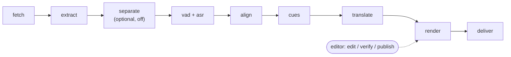
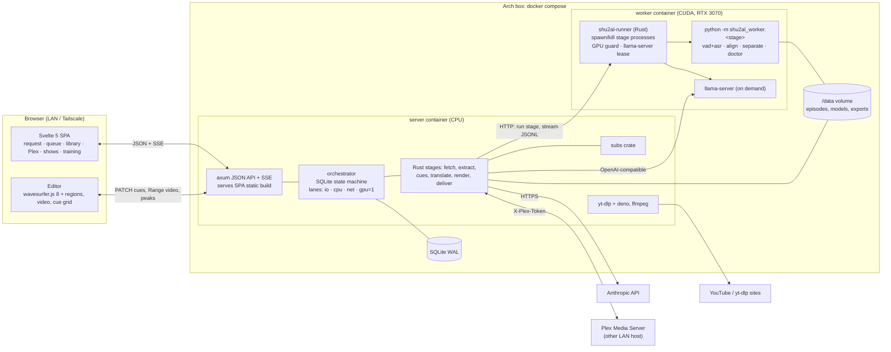

# shu-2al: scope and design (v2)

Status: **proposal, ready for M0** · Date: 2026-10-29 · Owner: Hamza

This doc is the single source of truth for what we build. It folds in the owner's answers from the design grilling and four research reports:

| Report | Covers |
|---|---|
| [research/asr-models.md](research/asr-models.md) | Arabic ASR models, Levantine benchmarks, timestamps, fine-tuning data |
| [research/translation.md](research/translation.md) | Levantine→English: API vs local LLMs, benchmarks, prior art, pricing |
| [research/media-and-subtitles.md](research/media-and-subtitles.md) | yt-dlp, ffmpeg, VAD/alignment, hallucination filters, Netflix rules. *§3+ incomplete; the TL;DR table is complete.* |
| [research/architecture.md](research/architecture.md) | Salvage audit, orchestration, worker contract, data model, Plex API, training export. *§10.1 (htmx) and §15.1 (native install) are **superseded** by this doc.* |

---

## 0. TL;DR

A self-hosted dashboard on the Arch box (RTX 3070, 8 GB) where you:
1. paste a YouTube URL or playlist, search a show name, drop a file, or pick an episode from Plex;
2. watch it get downloaded, transcribed and translated;
3. fix the subs in a waveform editor;
4. publish `.ar.srt` and `.en.srt` to Plex.

Every fix you make is saved as training data, for fine-tuning a Syrian-drama ASR later.

The pipeline is a **hard-coded workflow**, not a configurable module graph: fetch → extract → VAD + ASR → align → cues → translate → render → deliver.

**Components:**
- **Rust:** server, queue, subtitle logic, translation calls, Plex client.
- **Python:** a thin GPU worker that only runs models.
- **Svelte:** the dashboard.
- **Docker Compose:** runs it all on the Arch box.

**Models:**
- **ASR:** Cohere Transcribe Arabic 07-2026. Best open model on Levantine TV dialogue, Apache-2.0, fits in 8 GB.
- **Translation:** Claude via API by default, with a local Qwen3.5-9B as the offline fallback.

---

## 1. Scope

### In scope (v1)
- **Sources:**
  - YouTube and any non-DRM site yt-dlp supports: a single URL, a playlist with an episode range, or search by show name.
  - Local files: browser upload, or a watched import folder.
  - The owner's **Plex library** (on another LAN host), as both a source and a destination.
- **Language:** Levantine Arabic, with Syrian as the target dialect.
- **Outputs:** two separate tracks.
  - `.ar.srt`: an Arabic transcript in **MSA-normalized orthography** (Netflix Arabic style).
  - `.en.srt`: **natural English with some cultural flavor**.
- **Delivery:** download from the dashboard, plus **upload to Plex via its HTTP API**.
- **Review editor** with **full waveform timing**: wavesurfer.js regions, a 480p proxy video, AR/EN columns and keyboard-driven editing.
- **Corrections captured as training data:** audio span, ASR hypothesis, corrected Arabic, MT hypothesis and corrected English. Exportable as a Hugging Face `audiofolder` dataset.
- **Per-show memory:** a character list and glossary that grow from translation suggestions and editor fixes.
- **Bulk queueing for series bursts** (about 30 episodes overnight), with an optional Batch-API translation mode at 50% off.
- **GPU sharing with gaming:** the worker yields the GPU when a game is using it.
- **CI** on GitHub Actions for Rust, Python and Svelte, plus Docker image builds.

### Out of scope (v1), and where each item goes later
| Item | Status |
|---|---|
| Public or multi-user hosting, accounts, quotas | Not planned. Copyright and ToS exposure; would need a legal review first. |
| DRM sources (Shahid, OSN+, Netflix) | **Never.** No circumvention. yt-dlp's DRM error is shown as "not supported". |
| Auto-follow a series, i.e. sub new episodes as they drop | v2. Plex webhooks or a yt-dlp playlist poll. |
| Actual model fine-tuning | v2. v1 only *collects* the data. |
| Vocal/music separation | Built as an optional stage, **off by default** until it proves itself on corrected episodes. |
| Speaker diarization and dialogue dashes | v2. |
| Burned-in subs, stacked dual-language track, dubbing | Not planned. |
| Other dialects (Egyptian, Gulf…) | Possible later via a new profile. Nothing in v1 hard-codes Syrian except profile defaults. |

### Legal posture
- yt-dlp is a dependency and can be named openly.
- Downloading from YouTube is against YouTube's Terms. That is the owner's personal-use risk decision.
- The dashboard stays private (LAN/Tailscale only).
- Downloaded media and the training dataset are **never redistributed** and never pushed to a public Hub repo.
- The README will carry a "only process content you have the right to" line.

---

## 2. Decisions log (from the grilling)

| # | Question | Decision | Consequence |
|---|---|---|---|
| 1 | Where does inference run? | **Arch Linux box, RTX 3070 8 GB**. The M2 Mac is for dev only. | Models must fit in about 7 GB. GPU stages run one at a time, one process each. |
| 2 | How strict is "no Python"? | **Rust app + thin Python ML worker** | Python is limited to `worker/` (model calls). The orchestration, the worker supervisor (`runner`) and all logic are Rust. |
| 3 | Subtitle tracks | **English + Arabic (Syrian transcript)**, separate files | Two tracks share one timing template. |
| 4 | Sources | YouTube/yt-dlp sites, local files, **Plex** | Three fetchers behind one `Source` enum. |
| 5 | Translator | **API LLM, local fallback** | `TranslationProvider` enum: Anthropic plus OpenAI-compatible (llama-server). |
| 6 | Users | **Just me, LAN/Tailscale** | No accounts; an optional shared password. |
| 7 | Delivery | **Dashboard download + Plex** | Plex upload API, with sidecar-over-mount as fallback. |
| 8 | Request UX | **URL/playlist, upload/drop, search by name** | Preview table with parsed S/E before queueing. |
| 9 | Plex location | **Another machine on the LAN** | Push through the HTTP API, not the filesystem. |
| 10 | Plex as source | **Yes** | Browse Plex → "missing EN" badge → Generate → push back to the same `ratingKey`. |
| 11 | Review | **Editor + save corrections** | `cues` + `cue_edits` tables; audio is pinned once edited. |
| 12 | English style | **Natural, keep some flavor** | habibi/yalla kept when the meaning is clear; تقبرني → "I adore you"; يا خالتي → "Auntie". |
| 13 | Arabic style | **MSA-normalized orthography** | See §5.6. Raw ASR is also kept, so the convention can change later. |
| 14 | Retention | **16 kHz audio + 480p proxy** (+ peaks, shots) | About 250–350 MB per episode. The full download is deleted after extract. |
| 15 | Frontend | "Whatever is fastest and smoothest" → **Svelte 5 SPA** | Separate `web/` package in the **same repo** (monorepo). Typed API client generated from Rust. |
| 16 | Deployment | **Docker Compose + NVIDIA Container Toolkit** | Two images: `server` (CPU) and `worker` (CUDA). See §9. |
| 17 | CI | Required | GitHub Actions, path-filtered jobs (§11). |
| 18 | ASR bake-off | **No, ship Cohere** | The backend stays swappable. Automatic CER-from-corrections tracking replaces the bake-off (§8.3). |
| 19 | GPU also used for gaming | **Yes** | GPU guard: auto-pause on external VRAM use, a manual toggle, and an optional time window (§6.3). |
| 20 | Volume | **Whole-series bursts** | Bulk queue from a playlist range; Batch-API translation mode. |
| 21 | Editor depth | **Full waveform timing in v1** | wavesurfer.js 8 + Regions; precomputed `peaks.json`. |
| 22 | Workflow vs pipeline | Hard-coded if simpler (owner's call delegated) | **Hard-coded stages + a small typed TOML profile.** The JSON module graph is dropped. |

---

## 3. User flows

### 3.1 Request
| Entry | What happens |
|---|---|
| **Paste URL / playlist** | `yt-dlp --flat-playlist -J` produces a preview table: title, duration, channel, parsed series/season/episode, and a confidence score. You tick episodes or type a range (`-I 1:30`). Each one becomes an episode job. |
| **Search by name** | Typing `باب الحارة` runs 2–3 normalized query variants through `ytsearch20:`. Results are merged, filtered (duration > 20 min, allow-listed channels first), and deduped by (series, S, E). Best hit: the channel's *playlist* for that series. |
| **Upload / drop** | Streamed upload, or a watched `import/` folder. ffprobe runs, then an S/E form. |
| **Plex** | Library → show → season → episodes, each with AR/EN badges. A "missing EN" filter, then **Generate** (single or bulk). |

Every request is attached to a **show**: auto-matched by parsed title or Plex grandparent, or created. That is how the glossary and character list follow you across episodes.

### 3.2 Queue
- Each episode shows a stage strip (`fetch ▸ extract ▸ asr ▸ align ▸ cues ▸ translate ▸ render ▸ deliver`) with live percent and ETA over SSE.
- Actions:
  - cancel, retry a stage, rerun from a stage, change priority
  - **Pause GPU** (global toggle)
  - **Translate mode** per request: *now* (interactive) or *overnight* (Batch API, half price, results within 24 h, usually under 1 h)
- A banner shows "GPU busy (external)" when the guard is holding.

### 3.3 Review editor
- **Layout:** a 480p video, a waveform with cue regions, and a scrolling cue list (time · Arabic RTL · English).
- **Live checks:** CPS/CPL warnings, low-confidence highlighting, and an over-correction flag (§5.5).
- **Editing:** drag region edges to retime; split, merge, delete; **verify**.
- **Retranslate cue** uses context and the glossary.
- **Navigation:** shot-change markers on the timeline; a keyboard-first layout (§7.2).
- Autosave goes through `PATCH`. **Publish** re-renders the SRTs and re-pushes to Plex.

### 3.4 Publish / deliver
- Files are named `<Show> - S01E05.ar.srt` and `.en.srt`, UTF-8.
- **Plex:** `POST /library/metadata/{ratingKey}/subtitles` once per language. On re-publish, the previous stream is deleted first.
- **Download:** the dashboard serves both SRTs (and an optional MKV mux) per episode, or a zip per season.

---

## 4. Pipeline (hard-coded workflow)



| # | Stage | Runs in | Lane | Tool / model | Output | Est. time / 45-min ep (3070) |
|---|---|---|---|---|---|---|
| 1 | `fetch` | server (Rust) | io | yt-dlp (+deno), Plex part download, or local path | `source/media.*`, `info.json` | network-bound |
| 2 | `extract` | server | cpu | **one** ffmpeg pass (verified on ffmpeg 9.0.2): `audio.16k.flac` (mono s16), `proxy.mp4` (480p H.264/AAC, faststart, 2 s GOP), `shots.txt` (scdet); then Rust computes `peaks.json` | audio, proxy, shots, peaks | 1–3 min (CPU x264) |
| 3 | `separate` | worker | **gpu** | `audio-separator` with a Mel/BS-RoFormer vocal model, or htdemucs | `vocals.16k.flac` | +1–10 min. **Off** by default (§5.1) |
| 4 | `asr` | worker | **gpu** | **Silero VAD v6** → chunks ≤ 20 s → **Cohere Transcribe Arabic 07-2026** (BF16, transformers) → loop/repeat guard | `asr/transcript.json` (chunks, text, confidences, speech regions) | about 1–3 min (est. RTF 0.02–0.05) |
| 5 | `align` | worker | **gpu** | CTC forced alignment with `jonatasgrosman/wav2vec2-large-xlsr-53-arabic` (Apache-2.0) via `ctc-forced-aligner` / torchaudio `forced_align` | word-level times added to `transcript.json` | about 0.5–1.5 min |
| 6 | `cues` | server | cpu | `subs` crate: hallucination filter (§5.3), then segmentation by Netflix Arabic rules (§5.4), then shot snapping | `cues` rows (`ar_asr`), snapshot r0 | < 1 s |
| 7 | `translate` | server → API | net (API) / **gpu** (local) | Claude (default) or Qwen3.5-9B via llama-server (fallback). Emits corrected Arabic + English per cue (§5.5) | `ar_text`, `en_mt`/`en_text`, new glossary suggestions | 2–5 min interactive; under 24 h in batch |
| 8 | `render` | server | cpu | `subs`: English fit pass (Netflix EN rules), line breaking, Arabic bidi wrapping | `subs/{ar,en}.r<N>.{srt,vtt}` | < 1 s |
| 9 | `deliver` | server | net | Plex upload API (sidecar fallback); optional MKV mux | Plex stream ids | seconds |

**Total:** about 10 minutes per episode of wall time. The GPU is busy for about 3–5 minutes of that, so a 30-episode burst takes roughly 3–5 hours overnight. **All times are estimates; M1 measures them on the real box.**

**Stage rules:**
- GPU stages run **one at a time**, each in its **own process** that exits afterward. Exiting is the only reliable way to release CUDA memory on 8 GB.
- Every stage is idempotent and keyed by `input_hash`. Re-running a stage invalidates the stages downstream of it.
- Retries:
  - `fetch` and `deliver` retry 5× with backoff.
  - GPU stages retry 2×. A CUDA OOM gets the special code `gpu_contention`: it goes back to the queue, waits for the GPU guard, and does not burn an attempt.
  - `translate` honors `429 Retry-After`, then falls back to the next provider.

---

## 5. Stage details

### 5.1 Audio front end
- **Kept on disk:** 16 kHz mono FLAC, which is both the ASR input and the training data, plus the 480p proxy. The source file is deleted after `extract` (or after `separate`, if enabled, since separation needs 44.1 kHz stereo).
- **Separation:**
  - It is implemented as an optional stage but **off by default**. Nothing published shows it reliably lowers Arabic WER on drama, and it costs 1–10 min per episode.
  - Enable it per show once corrected episodes exist and the CER dashboard (§8.3) can show a win.
- **VAD:** Silero VAD v6 (MIT). Speech regions become the chunk boundaries and the coarse timestamps, which also kills most non-speech hallucinations.

### 5.2 ASR: Cohere Transcribe Arabic 07-2026
| Why | Detail |
|---|---|
| Best measured on Levantine TV dialogue | Casablanca (YouTube TV series): **JOR 23.3 / PAL 30.8 WER**, against Whisper-large-v3 at about 48 / 58. The per-country split is computed in asr-models.md §3.2a. Overall Casablanca WER is 45.68. Open-leaderboard average WER is 24.19. |
| Fits | 2.07B params, BF16 about 4.1 GB of weights, est. 5–6 GB peak. No quantization needed. |
| License | Apache-2.0 (gated: accept once on HF). |
| Gaps | **No timestamps** (hence VAD + `align`). Can loop on long or noisy clips (hence the ≤ 20 s chunks and a loop detector borrowed from Sygma-ASR). Rarely emits «اشتركوا بالقناة» (hence the filter). |

- **Swappable backends.** The worker's `asr` stage takes `backend` and `model` as opaque params. Prepared alternatives:
  - **Jais-ASR** (Q4 GGUF, 5 GiB, has a Syrian `SY` dialect flag and a no-speech refusal token).
  - **Whisper-large-v3-turbo Levantine fine-tune** (native timestamps, runs in Rust via whisper-rs, and is the cheapest to fine-tune on the 3070).
- **Rust-native option later:** `transcribe.cpp` has official Rust bindings and supports Cohere. Once VAD and alignment are proven, ASR could move in-process and shrink the Python surface further.
- **Prompting:** the show's character names are passed as a decoding prompt or hotwords if the backend supports it (TBD in M1).

### 5.3 Hallucination filtering (Rust, `cues` stage)
- **Normalized phrase matching.** Normalization strips diacritics and tatweel and unifies alef/ya/ta-marbuta.
  - A cue is dropped only when a known phrase **dominates** it (for example ≥ 70% of its characters).
  - This fixes the prototype bug where any cue merely *containing* "موسيقى" or "jungle" was deleted.
  - The phrase list is salvaged from the prototype into the profile.
- **Signal checks:**
  - ASR text outside VAD speech
  - repetition loops (n-gram repeat ratio)
  - CPS outliers
  - alignment score below threshold
- **Dropped cues are kept** with `status=deleted` and a reason. They serve as negative examples and stay visible in the editor's "hidden" filter.

### 5.4 Segmentation and formatting
| | Arabic track | English track |
|---|---|---|
| Max chars/line | 42 | 42 |
| Lines/event | 2 | 2 |
| Reading speed | ≤ 20 CPS (adult) | ≤ 20 CPS |
| Duration | 5/6 s – 7 s | same timing template |
| Min gap | 2 frames | — |
| Line breaks | at clause boundaries; bottom-heavy | bottom-heavy pyramid; dialogue hyphen without space for 2 speakers |

- The Arabic cues define the **timing template**, and English is fitted into the same events.
- The English **fit pass** in `render` re-breaks lines. If a cue still violates CPS, it is flagged, and in batch mode sent to a "shorten" LLM call along with its duration.
- **Shot snapping:** cue in/out points within 250 ms of a cut snap to the cut (with a 2-frame offset). It is essentially free because `shots.txt` comes from the extract pass.
- **Arabic SRT output:** UTF-8 without BOM, `‫…‬` (RLE/PDF) bidi wrapping per line. The wrapping is configurable, because Plex clients render RTL inconsistently. Verify on the owner's clients in M4.

### 5.5 Translation (Rust → LLM)

**Providers** (`TranslationProvider` enum in Rust; there is no official Anthropic Rust SDK, so it uses raw HTTP via reqwest):

| Role | Model | How | Cost per 45-min episode (est.) |
|---|---|---|---|
| **Default** | `claude-opus-5-5` (effort `medium`) | Messages API, structured outputs (`output_config.format` JSON schema), prompt caching on system + show brief | about $0.70–1.00 interactive · **$0.35–0.50 batch** |
| Cheaper option | `claude-sonnet-5-5` | same | about $0.35–0.50 · $0.18–0.25 batch |
| Budget option | `claude-haiku-5-5` | same | about $0.02–0.03 |
| **Offline fallback** | `Qwen/Qwen3.5-9B` Q4_K_M (5.7 GB), thinking off | llama-server (OpenAI-compatible) started **on demand inside the worker container** after ASR has exited | electricity only |

- **Cost basis:**
  - About 16k Arabic tokens in on a GPT-style tokenizer (measured 1.96 tokens per word on Syrian text), × about 1.3 for Claude's tokenizer.
  - About 30k tokens out, since the output carries corrected Arabic plus English plus JSON.
  - Prices as of 2026-10: Opus 5.5 $4/$20, Sonnet 5.5 $2/$10, Haiku 5.5 $0.10/$0.50 per M tokens. Batch is −50%.
  - Thinking tokens bill as output. **Measure with `count_tokens` in M1.**
- **Why Claude:**
  - No 2025–26 benchmark covers Levantine→English for frontier models, so this is judgment, not data.
  - Claude-3.5-Sonnet topped human ratings for Syrian-dialect responses in Palm (ACL 2025).
  - Frontier LLMs beat Google Translate and NLLB on Jordanian and Palestinian TV dialogue by COMET (TARJAMAT).
  - The API supports strict JSON schemas, caching and a batch mode.
  - The provider is swappable: an OpenAI-compatible variant covers DeepSeek, Gemini (via proxy), Ollama and llama-server.
- **Why Qwen3.5-9B as the fallback:**
  - Apache-2.0, and the Qwen3 family explicitly lists Levantine.
  - It can do *both* jobs (correct the Arabic and translate it), which translation-only models like HY-MT1.5 and TranslateGemma can't.
  - At Q4 it fits only when ASR is not loaded, which the GPU lane guarantees.
- **Refusals:** check `stop_reason == "refusal"`, enable server-side `fallbacks: "default"`, and if that still fails, fall back to the local provider. Drama contains violence; refusals should be rare for translation, but they must be handled.
- **API note:** don't send `temperature`/`top_p` (400 since 2026-10-21). Opus 5.5 can't disable thinking, so control it with `effort`.

**Batching and context** (patterns from llm-subtrans, VideoLingo, Lingarr and gnehs/subtitle-translator; details in research/translation.md):
1. **Episode brief pre-pass** (one call): synopsis, characters with gender, register, and new terms. Merged with the stored show brief.
2. **Scenes:** split at gaps ≥ 4 s or at shot changes with a gap ≥ 1.5 s. Batches hold 10–40 cues, and an oversized scene splits at its largest internal gap.
3. **Per-batch prompt, built in this order so the prefix caches well:**
   - system prompt and style guide (frozen)
   - show brief and approved glossary/characters (stable per show)
   - up to 5 **few-shot examples drawn from your own verified edits** for this show
   - the rolling summary
   - the last 8 cues with their translations
   - the batch itself
4. **Interactive mode** runs batches in order, so the rolling summary flows forward. **Batch mode** submits all of an episode's batches at once with the *Arabic-only* previous scene as context: slightly less consistent, half price.
5. **Validation in Rust:**
   - The ID set must match exactly. Recovery escalates: retry with the error list, then halve the batch, then single lines. Valid prefixes are kept, and nothing is padded with blanks.
   - English must be non-empty when Arabic is non-empty.
   - The CPS check runs in `render`.
   - **Over-correction guard:** if `ar_text` differs from `ar_asr` by more than 40% (character edit ratio, after normalization), the cue is flagged for review. It is never silently accepted.

**Output schema** (strict JSON schema; `additionalProperties: false` everywhere):

```json
{
  "lines": [
    { "id": 412,
      "ar": "شو بدك تعمل هلق؟",
      "en": "What are you going to do now?",
      "ar_changed": false,
      "uncertain": false }
  ],
  "scene_summary": "Abu Issam confronts Moataz in the shop about the missing money.",
  "new_terms": [ { "ar": "أبو عصام", "en": "Abu Issam", "kind": "name" } ]
}
```

**System prompt** (v0, to be tuned in M1; stored in `profiles/levantine-default.toml`):

```text
You are subtitling a Syrian TV drama. You receive numbered cues of Arabic dialogue that
an automatic speech recognizer transcribed. Expect recognition errors, missing words and
inconsistent dialect spelling.

For every cue, return exactly one object with the same id. Never merge, split, drop,
or reorder cues; timings depend on the ids.

"ar": the cue's Arabic, corrected and written in the orthography convention below.
  - Fix a word only when the surrounding context makes the intended word clear.
    If unsure, keep the recognizer's word and set "uncertain": true.
  - Do not paraphrase, summarize, or convert dialect to Standard Arabic vocabulary.
    Keep every dialect word (شو، هلق، بدي، منيح، هيك، لسا، مبارح).
  - Set "ar_changed": true if you changed anything other than spelling normalization.

"en": natural, idiomatic English that a viewer can read at subtitle speed.
  - Translate meaning and tone, not words. Contractions are fine. Keep it concise:
    if the Arabic is short, the English should be short.
  - Keep a little cultural flavor where the meaning is obvious from context:
    habibi, yalla, wallah, inshallah, Abu/Umm + name. Otherwise use the natural
    English equivalent (تقبرني → "I adore you", يا خالتي → "Auntie",
    الله يرحم والديك → "Bless you").
  - Use the glossary and character names exactly as given. Never translate names.
  - Match profanity and insults with equivalent severity. Do not censor or soften.
  - If a cue ends mid-sentence and the next continues it, end with "…" and start
    the next with "…".

Also return "scene_summary" (≤ 2 sentences, for continuity in the next batch) and
"new_terms" for recurring names or terms not already in the glossary.

Orthography convention for "ar": <inserted from §5.6>
```

**Learning loop:**
- `new_terms` land as **pending** glossary entries. You approve them on the show page; approved terms are injected into later episodes.
- Every English edit you **verify** becomes a candidate few-shot example for that show. The 5 most recent go into the cached prefix.

### 5.6 Arabic orthography convention (MSA-normalized)
This follows Netflix's Arabic guide §25: in dialect subtitles, words *pronounced* differently from their MSA written form keep their MSA spelling.

| Rule | Example (spoken → written) |
|---|---|
| Restore MSA consonants in shared words: ق (glottal stop) | آل → **قال**, ألب → **قلب** |
| ث / ذ / ظ pronounced as ت/س, د/ز, ض/ز | تلاتة → **ثلاثة**, كتير → **كثير**, دهب → **ذهب** |
| Standard hamza, alef maqsura and ta marbuta spelling | ماشي, على, حلوة |
| Expand the contracted preposition عَ | عالبيت → **على البيت**, عالشغل → **على الشغل** |
| **Keep dialect-only words** in their common spelling | شو، هلق، بدي، منيح، هيك، لسا، مبارح، ليش، وين |
| No diacritics, except shadda where it disambiguates | — |
| Arabic punctuation | ، ؟ ؛ and «» for quotes |

*To confirm with the owner after the first corrected episode. Raw `ar_asr` is always kept, so changing the convention later is just a re-render.*

---

## 6. System architecture



### 6.1 Components
| Component | Lang | Responsibility |
|---|---|---|
| `crates/subs` | Rust | Pure library: `Cue`, `Timestamp(ms)`, SRT/VTT parse and write (BOM, CRLF, multi-line), segmentation rules, Arabic normalization, filters, shift. Salvaged from the prototype (§12). |
| `crates/contracts` | Rust | Worker protocol and `transcript.json` types. Generates JSON Schema (schemars) for Python and **OpenAPI** (utoipa) for the Svelte client. |
| `crates/server` (`shu2al`) | Rust | axum API + SSE, orchestrator, Rust stages, translation providers, Plex client, training export. Subcommands: `serve`, `subs …` (CLI tools), `export`. |
| `crates/runner` (`shu2al-runner`) | Rust | Small HTTP service inside the worker container. It spawns one Python process per stage run, streams JSONL progress back, kills the process group on cancel, runs the **GPU guard**, and starts/stops llama-server on lease. Python never sees the DB or the network. |
| `worker/` | Python (uv) | Model code only: `vad_asr.py`, `align.py`, `separate.py`, `doctor.py`, `mock.py`. pydantic models validated against the generated schemas. |
| `web/` | TS + Svelte 5 | SvelteKit 2 (`adapter-static`, SPA mode). Typed client generated from OpenAPI. wavesurfer.js 8 for the editor. |

### 6.2 Worker contract (unchanged from architecture.md §5.3, transport added)
- **Call:** server → runner: `POST /runs` with the JSON request envelope `{protocol, stage, run_id, episode_id, inputs, output_dir, device, params}`.
- **Response:** a chunked **JSON Lines** stream, `{"type":"progress","pct":42,"msg":"…"}` lines followed by `{"type":"result",…}` or `{"type":"error","code":"gpu_contention"|…}`.
- **Cancel:** `DELETE /runs/{id}` sends SIGTERM to the process group, then SIGKILL after 10 s.
- **Process lifetime:** one process per stage run, exiting at the end, so CUDA memory is always returned.
- **Health:** `GET /doctor` reports GPU, VRAM, driver, torch/CUDA versions and model cache status.
- **Dev on the M2:** `worker.mode = "mock"` replays fixture transcripts with fake progress, so all UI, queue, editor and Plex work runs without a GPU.

### 6.3 GPU scheduling and the gaming guard
- **One GPU lane** with concurrency 1, which covers separate, asr, align and local translate. CPU, IO and API stages run in parallel with it.
- **Guard (in the runner)**, checked before claiming a GPU job and every 30 s while waiting:
  1. **Manual pause**: a toggle in the dashboard, which can also be set from a CLI command or a Steam launch option such as `curl …/gpu/pause`.
  2. **External VRAM use**: `nvidia-smi --query-gpu=memory.used`. More than `gpu.external_threshold_mb` (default 1200) used while no stage of ours is running means a game or other app holds the GPU, so wait. This works inside the container. Process names from the host are not visible in a container, which is why this uses VRAM, not PIDs.
  3. **Optional window**, e.g. GPU stages only run 00:30–09:00. Good for overnight series bursts.
- **Mid-run contention:** a game launched during a stage causes CUDA OOM, which is reported as `gpu_contention`. The stage is requeued without consuming an attempt and waits for the guard.
- **Model loads** take about 5–20 s per stage process. That's negligible next to a 45-minute episode and buys clean VRAM.

### 6.4 Orchestration
This is the hand-rolled durable state machine from architecture.md §7: SQLite `stage_runs` rows, lanes, claim/heartbeat, retries with `run_after`, `input_hash` invalidation, and crash recovery on boot (`running` → `queued`).
- **Bulk enqueue:** one transaction for N episodes.
- **Priority:** single-episode requests jump ahead of a running overnight burst.

---

## 7. Dashboard (Svelte)

### 7.1 Pages
| Page | Contents |
|---|---|
| **New** | URL/playlist paste → preview table (parsed S/E, confidence, duplicates greyed out) → tick/range → queue. Search tab. Upload/drop. Profile + show picker. Translate mode *now / overnight*. |
| **Queue** | Live stage strips (SSE), ETA, the GPU guard banner, Pause GPU, bulk cancel/retry, log drawer (run log + worker stderr tail). |
| **Library** | Shows → seasons → episodes. Badges: AR/EN, % reviewed, Plex delivery revision, estimated CER. Downloads (SRT/VTT/zip). |
| **Plex** | Browse libraries, "missing EN" filter, Generate (bulk), delivery status. |
| **Show** | Synopsis, style notes, characters (AR/EN/aliases/gender), glossary with **pending** suggestions to approve, few-shot examples pulled from verified edits. |
| **Editor** | §7.2. |
| **Training** | Hours reviewed by show/status, **ASR CER and MT edit-rate trends** (§8.3), Export button. |
| **Settings** | API keys (stored in the config file, never the DB), Plex URL/token + test, GPU policy, yt-dlp version + update, retention/GC, worker doctor. |

### 7.2 Editor (v1 = full waveform timing)
- **Waveform:** wavesurfer.js 8 with the Regions, Timeline, Minimap and Zoom plugins.
  - It loads `peaks.json`, which the server precomputes from the 16 kHz FLAC, so a 45-minute episode renders instantly with no client-side audio decoding.
  - Playback uses the `<video>` element (proxy.mp4) as the media source.
- **Cue grid:** virtualized (about 800 rows); Arabic column with `dir="rtl"`; English column; live CPS/CPL counters.
- **Badges:** low confidence, over-correction, stale EN.
- **Region interaction:**
  - Dragging an edge retimes the cue, snapping to shot markers and to neighbors with a 2-frame gap.
  - The overlap between neighbors is enforced.
- **Keyboard:**

  | Key | Action |
  |---|---|
  | Space | play/pause |
  | J / K | previous / next cue |
  | R | replay cue |
  | [ / ] | set in / out to the playhead |
  | Alt+←/→ | nudge ±100 ms |
  | Ctrl+Enter | verify + next |
  | S | split at the text caret / playhead |
  | M | merge with next |
  | Del | delete |
  | T | retranslate |
  | Ctrl+Z | undo (local stack mirrored by `cue_edits`) |

- **Saving:** optimistic `PATCH /api/cues/{id}`, batched every 500 ms. When Arabic is edited, the English is marked **stale** and a one-click retranslate is offered.
- **Publish** re-renders a new track revision and re-pushes to Plex.

---

## 8. Data

### 8.1 Data model
The SQLite schema in architecture.md §12 is adopted as-is (`shows`, `characters`, `glossary_terms`, `requests`, `episodes`, `stage_runs`, `run_log`, `artifacts`, `cues`, `cue_edits`, `subtitle_tracks`, `plex_deliveries`, `training_exports`), with these additions:
- `glossary_terms.status` (`pending | approved | rejected`) and `source` (`llm | editor | manual`).
- `cues.flags` (JSON: `low_conf`, `overcorrected`, `cps_violation`, `filtered_reason`).
- `episodes.translate_mode` (`interactive | batch`), and `translate_batches(batch_id, episode_id, status, submitted_at)` for Batch API polling.
- `fewshot_examples` (view): the verified cues of a show where `en_text != en_mt`, newest first.

### 8.2 Artifacts (per episode, on the `/data` volume)
`episodes/<ulid>/`
- `audio/`: `audio.16k.flac` (**pinned** once any cue is edited), `proxy.mp4`, `peaks.json`, `shots.json`, optional `vocals.16k.flac`
- `asr/`: `transcript.json`, `request.json`
- `subs/`: `ar.rN.srt`, `en.rN.srt`, VTT copies

The source media is deleted after extract. Expect about 250–350 MB per episode, or about 10 GB for a 30-episode series.

### 8.3 Corrections → training data and passive model evaluation
- Each cue keeps an immutable `ar_asr` (recomputed from transcript words whose midpoint falls inside the span whenever the cue is retimed) and an immutable `en_mt`, alongside the current `ar_text` / `en_text`. Every change is appended to `cue_edits`.
- **Export:** a Hugging Face `audiofolder` dataset (16 kHz FLAC clips ±200 ms plus `metadata.jsonl`), with deterministic **per-episode** splits. Private only. Details are in architecture.md §11.
- **This replaces the bake-off.** On every Publish, the server computes **CER(`ar_asr` → `ar_text`)** over verified and edited cues, plus the **English edit rate** (`en_mt` → `en_text`). Both are stored per episode, model and profile version.
  - The Training page plots them per show.
  - If Cohere underperforms on Syrian drama, it shows up after a couple of reviewed episodes, and swapping in Jais-ASR or a Whisper fine-tune is a profile change.
  - Note: MSA normalization inflates raw CER, so CER is computed after normalizing both sides with the same orthography folding.

---

## 9. Deployment: Docker Compose on Arch

```yaml
# deploy/compose.yaml (sketch)
services:
  server:
    build: { context: .., dockerfile: deploy/server.Dockerfile }   # Rust binary + SPA build + ffmpeg + deno
    ports: ["${BIND_IP:-127.0.0.1}:8080:8080"]                      # bind to the LAN/Tailscale IP only
    volumes:
      - data:/data
      - ./config.toml:/config/config.toml:ro                       # API keys, Plex token (0600 on host)
      - ${IMPORT_DIR:-./import}:/import:ro
    environment: [ "WORKER_URL=http://worker:7070" ]
    depends_on: [ worker ]
    restart: unless-stopped
  worker:
    build: { context: .., dockerfile: deploy/worker.Dockerfile }   # CUDA 12 runtime + uv venv + shu2al-runner + llama-server
    volumes: [ "data:/data", "models:/models" ]
    environment: [ "HF_HOME=/models/hf" ]
    deploy:
      resources:
        reservations:
          devices: [ { driver: nvidia, count: 1, capabilities: [gpu] } ]
    restart: unless-stopped
volumes: { data: {}, models: {} }
```

**Host setup (Arch):**
- `nvidia` (or `nvidia-open`) driver, `docker`, `docker-compose`, `nvidia-container-toolkit`, then `nvidia-ctk runtime configure --runtime=docker`.
- Pin the driver with `IgnorePkg`, or update it deliberately: Arch's rolling updates can break CUDA mid-burst.
- CUDA user-space lives inside the worker image, so Arch's CUDA 13 versus CTranslate2/PyTorch's CUDA 12 never conflicts.

**yt-dlp upkeep:**
- yt-dlp is installed into `/data/tools/yt-dlp` (a venv on the volume), so the **"Update yt-dlp" button / weekly job** works without rebuilding the image.
- Its version is logged per job.
- deno is required for YouTube's JS challenges.

**Upgrades:** `git pull && docker compose build && docker compose up -d`. SQLite migrations run on boot, and a nightly `VACUUM INTO` backup goes into `/data/backups`.

**Images:**
- CI builds both images and pushes them to GHCR on tags.
- The worker image is large (about 8–10 GB with torch and CUDA). Models live in the `models` volume, not the image.

---

## 10. Plex integration (summary of architecture.md §9)
- **Auth:** the server owner's `X-Plex-Token` (pasted in Settings for v1; PIN flow later) goes in a header and is stored in the config file only. The base URL is `http://<plex-lan-ip>:32400`, with a "Test" button that calls `/identity`.
- **Browse:** `/library/sections`, `/library/sections/{id}/all?type=2`, `/library/metadata/{key}/children`. Existing subtitle streams (`streamType=3`, `languageCode`) are read to compute the "missing EN" badge.
- **Pull:** `GET {Part.key}?download=1`, streamed to the volume. Alternatively, read in place via an optional read-only mount plus `path_map`.
- **Push:** `POST /library/metadata/{ratingKey}/subtitles?title=<Show> - S01E05.en.srt&format=srt` with the raw SRT body, then re-read the item to record the stream key. Re-publish deletes the old stream before uploading.
- Episodes store `plex_rating_key` and `plex_guid`, and re-resolve by GUID if Plex re-matches an item.
- **Verify in M4:** that uploads are tagged with the right language (inferred from the `.ar`/`.en` suffix, UNVERIFIED), and that Arabic RTL renders correctly on your Plex clients. If not, use the sidecar-over-writable-mount fallback.

---

## 11. CI (GitHub Actions)

`.github/workflows/ci.yml` runs on PRs and `main`, with jobs path-filtered (`dorny/paths-filter`):

| Job | Steps |
|---|---|
| **rust** | toolchain from `rust-toolchain.toml` · `cargo fmt --check` · `cargo clippy --workspace --all-targets -- -D warnings` · `cargo test --workspace` (SQLx offline mode, `.sqlx/` committed) · `cargo deny check` (licenses/advisories) |
| **contracts** | regenerate JSON Schemas + OpenAPI + the TS client, and fail if `git diff` is non-empty (keeps Rust, Python and Svelte in lockstep) |
| **worker** | `uv sync --frozen` (CPU torch extra) · `ruff check` · `ruff format --check` · `pytest` (contract validation against schemas, the mock stage, the VAD/chunking logic on a tiny fixture; no GPU) |
| **web** | `pnpm install --frozen-lockfile` · `svelte-check` · `eslint` · `vitest` · `vite build` |
| **e2e** (main only) | spin up the server with `worker.mode=mock`, then Playwright: request → queue → editor → publish (Plex mocked) |
| **docker** | `docker buildx build` both images with GHA cache. Push to GHCR on `v*` tags (`release.yml`). |

Caching: `Swatinem/rust-cache`, `astral-sh/setup-uv` cache, pnpm store cache. Dependabot (or Renovate) covers cargo, uv, npm and GitHub Actions.

---

## 12. Repo layout and salvage

Everything stays in **this repo** (a monorepo), so one CI and one PR can touch API, worker and UI together.

```
shu-2al/
  Cargo.toml                  # workspace, edition 2024
  rust-toolchain.toml         # pinned stable; the local 1.78 is too old for sqlx 0.9 / axum 0.8
  crates/
    subs/                     # salvaged + fixed SRT/VTT/cue logic (pure, no I/O)
    contracts/                # worker protocol, transcript types, schema + OpenAPI generation
    server/                   # shu2al binary: api, orchestrator, stages, providers, plex, export
    runner/                   # shu2al-runner: worker-side supervisor + GPU guard
  worker/                     # Python (uv): shu2al_worker/{vad_asr,align,separate,doctor,mock}.py, tests/
  web/                        # SvelteKit SPA: routes/, lib/api (generated), lib/editor/
  profiles/levantine-default.toml
  deploy/                     # compose.yaml, server.Dockerfile, worker.Dockerfile, config.example.toml
  .github/workflows/          # ci.yml, release.yml
  docs/DESIGN.md  docs/research/
  crates/subs/tests/fixtures/ # real Whisper/Arabic SRT fixtures
```

**Salvage verdict** (architecture.md §1): **about 900 of the 1,644 lines survive** inside `crates/subs`. These are the timestamp, cue, filter and offset logic, their 28 tests, the fixtures and the hallucination-phrase list.

**Dropped:**
- the `Module`/`Source` traits
- `pipeline.rs` and the JSON profiles (their knobs become typed TOML fields)
- `language.rs`
- the Whisper stub (its option docs are kept as reference)
- the empty Dockerfile

**Bugs fixed during the move:**
- multi-line cues are truncated
- the parser silently drops "hallucination" cues, including any cue containing "jungle"
- VTT `.` timestamps are rejected
- errors are swallowed
- the `srt_loader` test never runs

**Profile sketch** (`profiles/levantine-default.toml`, typed with serde `deny_unknown_fields`; optional stages are `Option<…>`):

```toml
id = "levantine-default"
version = 1

[asr]
backend = "cohere-transformers"
model = "CohereLabs/cohere-transcribe-arabic-07-2026"
max_chunk_s = 20

[vad]
model = "silero-v6"
min_silence_ms = 300

[align]
model = "jonatasgrosman/wav2vec2-large-xlsr-53-arabic"

# [separate]                      # omitted → stage skipped
# model = "mel-roformer-vocals"

[cues]
max_cpl = 42
max_lines = 2
max_cps = 20.0
min_dur_ms = 833
max_dur_ms = 7000
snap_ms = 250

[cues.filters]
dominance = 0.7
phrases = ["اشتركوا في القناة", "لا تنسوا الاشتراك", "ترجمة نانسي قنقر", "المترجم للقناة", "موسيقى"]

[translate]
provider = "anthropic"
model = "claude-opus-5-5"
effort = "medium"
fallback = "local-qwen"
scene_gap_s = 4.0
batch_min = 10
batch_max = 40
context_cues = 8
fewshot = 5

[render]
ar_bidi = "rle"
en_fit = true
```

---

## 13. Milestones

| M | Deliverable | Done when |
|---|---|---|
| **M0** | Monorepo skeleton, toolchain, **CI green**, `crates/subs` salvaged with the bugs fixed and tests added | `cargo test` + CI pass; SRT/VTT round-trips multi-line, BOM and CRLF fixtures |
| **M1** | **CLI vertical slice on the 3070:** local file → extract → worker vad+asr → align → cues → translate (Claude) → `.ar.srt` + `.en.srt` | a real Syrian episode subbed end to end; **measured** VRAM, timings and token cost recorded in this doc; prompt v1 tuned |
| **M2** | Server + SQLite state machine + runner + GPU guard + Compose; New and Queue pages; yt-dlp URL/playlist/search/upload | queue a 10-episode playlist range overnight; a game launch pauses work and it resumes cleanly |
| **M3** | **Editor** (waveform, regions, cue grid, shortcuts, retranslate, publish) + corrections tables + CER tracking | you can review an episode faster than real time |
| **M4** | Plex browse / pull / push, delivery status, RTL check on your clients | Generate from Plex → subs show up in Plex, tagged AR/EN |
| **M5** | Training export, glossary suggestions → approval, few-shot from edits, Batch-API mode | an `audiofolder` export loads with `datasets`; a 30-episode burst runs in batch mode |
| v2 | Fine-tune (Whisper-turbo LoRA on the 3070, or Cohere on a rented 24–48 GB GPU), separation A/B, diarization, auto-follow series | — |

---

## 13a. M1 measurements (2026-10-30, RTX 3070, 5:10 dialogue clip from ضيعة ضايعة S1E2)

| Stage | Warm time | Peak VRAM | Notes |
|---|---|---|---|
| ASR: Silero VAD + Cohere Transcribe Arabic (bf16, batch 8) | 8.4 s (RTF 0.027, ~37× real time) | 4.4 GB | 25 chunks covering 272 s of speech. Arabic is readable and punctuated, even in coastal dialect. |
| Align: wav2vec2-xlsr-53-arabic CTC | 3.5 s | 0.85 GB | 2 of 25 segments failed and fell back to proportional timing. |
| Cues | < 0.1 s | — | 70 cues |
| Translate: Qwen3.5-9B Q4_K_M, llama-server | 76 s (63 tok/s) | 5.9 GB | Includes about 10 s of server start. GPU back to 10 MiB afterwards. |
| **Total** | **99 s** | | Projects to **about 13 min per 45-min episode**, about 6.5 h for a 30-episode overnight run. |

**Lessons:**
- Small models loop inside schema-constrained JSON strings. The first run took 802 s because three runaway generations each hit the 8192-token cap.
- Fixed with: the DRY sampler, exact `minItems`/`maxItems`, `maxLength` on strings, a token budget proportional to batch size, and batches of at most 25.
- `docker --env-file` keeps the quotes around `.env` values, so tokens go through dotenvy and `-e NAME`.
- Worker containers run as the data dir's owner so artifacts aren't root-owned.

**Quality (local 9B):**
- It gets the gist on roughly half the lines.
- It often misses stock Syrian idioms («ما بتقصر», «يقطع عمرك»).
- About 30% of English cues overflow 2×42 characters even with a per-cue `max_chars` budget.
- It can drift one cue out of step in lyric-heavy passages.

**Next quality levers, still local:**
1. A shorten pass for overflowing cues.
2. A drift check comparing each source line with its translation.
3. A larger mixture-of-experts model with expert offload to the 62 GB of system RAM (Qwen3.6-35B-A3B or Jais-3-MoVA-36B-A4B).

### Translation bake-off (2026-10-30, same 70-cue clip)

| Translator | Time for 70 cues | Per 45-min episode | Notes |
|---|---|---|---|
| Qwen3.5-9B Q4 + slip check + shorten pass | 138 s | ~20 min | Shorten pass fixed 19 of 21 overflowing cues. Weak on idioms. |
| Qwen3.6-35B-A3B Q4, experts on CPU (`--cpu-moe`) | 319 s (33 tok/s) | ~45 min | Better on idioms (بخاطرك, أمانة يا جاري). Sometimes drops content or mistranslates names (عزرايلين → "Ezra family"). |
| NLLB-1.3B, LoRA on UFAL + Levanti (161k pairs, 2.1 h on the 3070, 4.4 GB) | 10 s | ~1.5 min | chrF++ on held-out UFAL rose from 47.4 to 54.2, **but it is clearly worse on real drama**: literal and context-free ("pinch your teeth", "the Israelis"). UFAL is movie subtitles translated into dialect, not native Syrian speech. |

**Decision:**
- Keep the LLM path, with the 9B as the default for overnight bursts and the MoE as an opt-in quality mode.
- The NLLB `mt` stage and `train_mt` stay as experiments. They become worth retrying once the editor has produced corrected pairs from real episodes.
- The biggest remaining quality lever is the owner's own corrections: per-show glossary and few-shot examples (M3/M5).

### M2 status (2026-10-31)

**Built:**
- `shu2al serve`: axum JSON API + SSE, SQLite queue, title parser, gaming guard.
- Svelte 5 dashboard with Queue and New request pages. Requests come from a URL, a playlist, a YouTube search, or a file path on the server.

**How the queue schedules:**
- Lanes: gpu = 1, io = 2, cpu = 4.
- GPU stages wait while the GPU is paused or while other apps use more than 1200 MiB of VRAM.
- `gpu_contention` failures requeue after 2 minutes without using an attempt.
- Other failures retry once after 30 s; fetch gets 4 attempts.

**Deviations from the plan, for now:**
- The server runs natively on the Arch box (`~/shu2al-data/start-server.sh`) and spawns worker and llama-server containers itself. Compose packaging and the `runner` service are deferred until we need them.
- The frontend is plain Vite + Svelte with hash routing instead of SvelteKit. It has fewer moving parts and is enough for these pages.
- Cancel stops scheduling but lets a running stage finish.
- The downloaded source is kept after extract, so the M3 editor can build its video proxy from it.

## 14. Risks and open items

| Risk | Mitigation |
|---|---|
| Cohere was chosen without a Syrian-drama eval (public evidence is Jordanian and Palestinian TV) | Swappable backend + automatic CER-from-corrections per episode (§8.3). Jais-ASR (Syrian flag) is the first alternative. |
| Arabic CTC aligner (trained on MSA Common Voice) may drift on noisy drama | VAD-chunk timing as fallback; shot snapping; the editor makes retiming cheap; A/B against Omnilingual CTC (`apc_Arab`) if needed. |
| A game starting mid-stage → OOM | `gpu_contention` requeue without burning attempts; guard; optional time window. |
| yt-dlp/YouTube breakage, bot checks | Updatable yt-dlp venv on the volume + update button; polite sleeps; cookies optional (account-ban risk noted). |
| Plex upload language tagging / RTL rendering on clients (UNVERIFIED) | Verify in M4; sidecar fallback; configurable bidi wrapping. |
| API refusal on violent or profane scenes | `stop_reason` check → server-side fallback → local Qwen. |
| Translation cost creep (thinking tokens) | `effort` knob, Batch mode, a per-episode token/cost readout in the Queue page, and a model switch in the profile. |
| Copyright/ToS | Private dashboard, no redistribution, private dataset, never DRM. |
| Rate limits during development (seen during this research) | Mock worker mode; fixtures; record/replay of LLM responses in tests. |

**Open, to settle during M1/M3 (none block M0):**
1. **Translation backend.** *Decided (2026-10-29):* **local only**, Qwen3.5-9B Q4_K_M via llama-server on the 3070, with JSON-schema-constrained output and thinking off. This avoids per-token cost and any question of subscription terms: Claude Max and ChatGPT plans don't include API credits, and scripting `claude -p` on a subscription isn't clearly permitted. API providers (§5.5) remain an optional backend if local quality disappoints.
2. The orthography convention table (§5.6): confirm it after reviewing the first episode.
3. Whether to pass character names as an ASR prompt (depends on Cohere's API support).
4. Whether to enable separation per show once the CER data exists.
