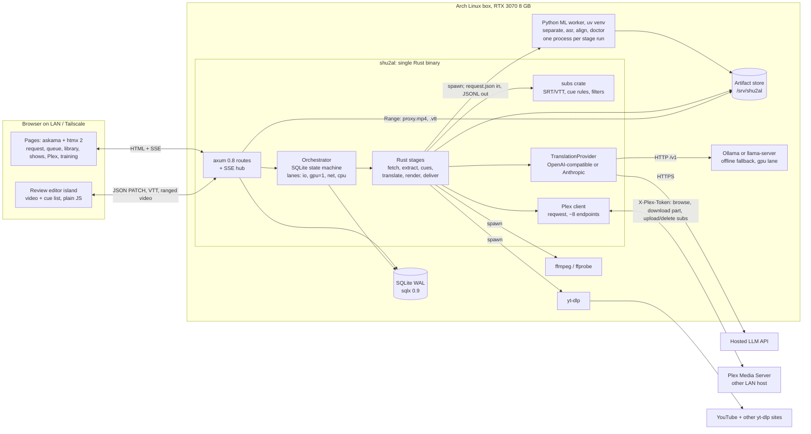
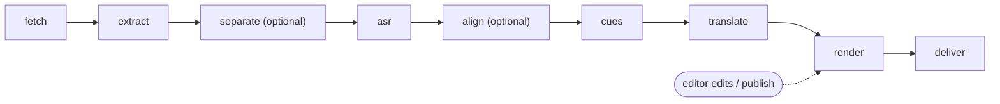

# shu-2al: system architecture proposal

> **Superseded in part by [../DESIGN.md](../DESIGN.md):** §10.1 (htmx → Svelte 5 SPA) and §15.1 (native install → Docker Compose). Everything else is adopted as-is.

Status: proposal · Date: 2026-10-27 · Scope: overall system, orchestration, worker boundary, dashboard, Plex, training-data capture.
The ASR model, the translation model/prompting, and media preprocessing are being researched separately. This document keeps clean stage boundaries so any of those choices can be dropped in.

Versions were checked on 2026-10-27 against crates.io, PyPI, the npm registry and the Rust channel manifest (see [§16](#16-version-table-checked-2026-10-27)). Anything marked **UNVERIFIED** could not be confirmed and should be tested before you rely on it.

---

## 0. Decisions at a glance

| Topic | Decision |
|---|---|
| Topology | One **Rust binary** (`shu2al`) runs the dashboard, scheduler, SRT logic, translation calls and Plex client. A **thin Python ML worker**, managed by uv, only runs models. Both live on the **Arch Linux box with the RTX 3070 (8 GB)**. Plex runs on another LAN host. |
| Worker boundary | The Rust side **spawns one worker subprocess per ML stage run**. The request goes in as a JSON file, and progress, result and error come back as JSON Lines on stdout. There is no Python server and no Python access to the DB. |
| Inference runtime | Python worker for v1, since the model is undecided and source separation and alignment are Python-only. `whisper-rs` is the escape hatch if the final model is a Whisper fine-tune and you want ASR without Python. |
| Orchestration | A **hand-rolled durable state machine in SQLite** (sqlx 0.9, WAL) with tokio lanes: `io`, `gpu` (=1), `net`, `cpu`. apalis 1.0 was evaluated and deferred. |
| Progress to UI | **SSE** (`axum::response::sse`) carrying server-rendered HTML fragments that the htmx SSE extension swaps in. |
| Dashboard | **axum 0.8 + askama 0.16 + htmx 2.0**, server-rendered. The review editor is one plain-JS island (native `<video>` + `<track>`). No SPA, Leptos or Dioxus. |
| Translation | Runs in Rust. A `TranslationProvider` enum has two variants: **OpenAI-compatible HTTP** (hosted APIs, Ollama, llama-server, vLLM) and **native Anthropic**. A hosted API is the default and a local LLM is the offline fallback, which takes the GPU lane. |
| Tracks | Two separate files, **`.ar.srt` + `.en.srt`**, plus `.vtt` copies for the browser. Muxing into MKV is optional and off by default. |
| Plex delivery | **HTTP API upload** (`POST /library/metadata/{ratingKey}/subtitles`) to the item. On re-publish, delete the old stream and upload again. Writing a sidecar over a mount and then refreshing the item is the documented fallback. |
| Plex as source | Browse through the PMS API. Pull media with the **part download endpoint**, or read it from an optional read-only mount via a path map. Push subs back to the same `ratingKey`, which is stored on the episode. |
| Corrections | Every edit is stored per cue with an immutable ASR hypothesis and the first machine translation. Export goes to a **Hugging Face `audiofolder` dataset**: 16 kHz FLAC clips plus `metadata.jsonl`, with deterministic splits by episode. |
| Config | **Hard-coded workflow plus small typed profiles** (TOML, serde `deny_unknown_fields`, schemars JSON Schema). Optional stages are `Option<…>`. There is no JSON module graph. |
| Hosting | **Native install on Arch**: a systemd service for the Rust binary, with uv-managed CPython pinned for the worker. Docker with nvidia-container-toolkit is deferred until a remote GPU is real. |
| Salvage | Keep and refactor the `core` types and logic, the filter/offset logic, their roughly 25 tests and the fixtures into a pure `subs` crate (§1). Drop the pipeline, the traits, the whisper stub and the Dockerfile. |

---

## 1. Salvage assessment of the prototype

Baseline: 1,644 lines. `cargo test` passes all 28 tests, built against an external target dir with rustc 1.78. That toolchain is **too old**: stable is 1.99.1, sqlx 0.9 needs 1.94, askama 0.16 needs 1.88 and tokio needs 1.85. Run `rustup update` and add a `rust-toolchain.toml`.

### 1.1 Bugs found by probing the built binary

I fed a 5-cue SRT through `main.rs`'s read/write round trip. It returned only cues 1 and 3, and reported success.

| # | Symptom | Cause |
|---|---|---|
| 1 | Multi-line cues lose every line after the first ("line two" vanished) | `Subtitle::new` takes only `lines[ts_i + 1]` (`src/core/subtitle.rs:79`). `SRT::read_file` then pushes the leftover line into the next block (`src/core/srt.rs:48-55`). |
| 2 | Cues containing a hallucination phrase are **silently dropped at parse time** | `Subtitle::new` calls `is_valid()`, which applies the hard-coded `WORDS_LIST` (`subtitle.rs:36-44, 92-94, 131-136`). Parsing and filtering are conflated. |
| 3 | "jungle gym" is dropped | Substring match against `"jungle"` / `"patch"` in `WORDS_LIST` gives false positives. |
| 4 | WebVTT-style `00:00:11.000` timestamps are silently dropped | `Timestamp::from_string` only accepts `,` (`src/core/timestamp.rs:49-52`). |
| 5 | Malformed input still returns `Ok(())` | `read_file` swallows per-block errors (`srt.rs:51`). |
| 6 | Leftover debug code | `if start_time == "00:03:11,080"` (`subtitle.rs:81-83`). |
| 7 | The `srt_loader` test never runs | `mod tests` has no `#[cfg(test)]` or `#[test]` (`src/source/srt_loader.rs:28-37`). It would fail if it did run, because `Subtitle::new` always sets `index: 0`. |
| 8 | `OffsetModule` can't be built outside its own tests | Its fields are private and it has no constructor (`src/modules/offset.rs:12-19`). |
| 9 | A configured Whisper source could never be used | `Source::process(input)` takes no `&self` (`src/source/source.rs:21`), so `WhisperConfig`'s fields are unreachable. |

### 1.2 Keep (refactor into `crates/subs`, a pure library with no I/O dependencies)

| From | Keep | Change |
|---|---|---|
| `src/core/timestamp.rs` | Parse, format, ordering, offset logic, and 20 tests (`:41-130`, `:171-304`) | Store a single `u64` of milliseconds so `Ord` can be derived. Accept `,` and `.`. Validate mm/ss < 60. Add `to_vtt()`. Replace `Direction` with signed durations. |
| `src/core/subtitle.rs` | `Subtitle` (rename to `Cue`), `duration()`, `offset()`, tests (`:157-270`) | Remove `WORDS_LIST` and `is_valid()` from parsing. Text becomes multi-line. Add an `id` that is stable across edits. |
| `src/core/srt.rs` | The reader/writer idea and the fixture test | Rewrite as `parse_srt(&str) -> Result<Vec<Cue>, ParseError>`, `parse_vtt`, `write_srt(&[Cue], impl Write)` and `write_vtt`. Handle BOM, CRLF and multi-line text. Report errors with line numbers. Decouple from file paths. |
| `src/modules/filter.rs` (`:30-62`) | The filter logic: phrase list, empty removal, re-index | Becomes `filters::hallucinations(&mut Vec<Cue>, &FilterRules)` inside the `cues` stage. Matching runs on normalized whole phrases (strip diacritics and tatweel, unify alef/ya forms). Add repetition-loop and confidence-based rules. |
| `src/modules/offset.rs` (`:31-47`) | Shift logic | Becomes `shift(&mut [Cue], i64 ms)`, used by the editor's "shift all after here". |
| `subtitle.rs:36-44` and the phrase lists in `examples/*.json` | **Domain knowledge**: YouTube-subtitle hallucination phrases | Move into `profiles/levantine-default.toml` (`cues.filters.phrases`). |
| `examples/ar_to_en_profile.json` | Intended ASR knobs: `beam_size` 10, `word_timestamps`, `hallucination_silence_threshold` 5, 2 lines × 50 chars; the "deepseek" translator idea | Turn these into typed profile fields and provider config. |
| `src/source/models/whisper.rs:28-117` | Doc comments for Whisper decoding options | Keep as reference for the worker's ASR backend params. Drop the Rust struct. |
| `test_files/` | Fixtures, including a real Arabic SRT | Add fixtures for multi-line cues, BOM, CRLF, VTT, and the bad cases from §1.1. |
| `README.md` | Name, motivation, vision | Update the architecture section. |

### 1.3 Drop

- `src/pipeline.rs`: a stub. The config is private and never called, `source`/`modules` are `serde_json::Value`, and `run()` is empty.
- `src/modules/module.rs`: the `Module` trait over `Arc<Mutex<SRT>>`. Locking is pointless for a sequential transform, and the trait can't express stages that change type (audio → transcript → cues).
- `src/source/*`: the `Source` trait, `srt_loader.rs`, and the empty `youtube_loader.rs`. Also the empty `modules/synchronizer.rs` and `modules/translator.rs`.
- `src/core/language.rs`: a 113-variant copy of Whisper's language list with no codes and no serde. Replace it with BCP-47/ISO-639 strings (`"ar"`, `"en"`, dialect tag `"apc"`).
- `src/core/error.rs`: it mixes source errors into core. Use one `thiserror` enum per crate.
- `src/main.rs`: the SRT round-trip CLI. Its job moves to `shu2al subs …` subcommands in the new binary.
- `dockerfiles/Dockerfile.prod`: empty, and the deploy is native (§13).

**Verdict:** about 900 of the 1,644 lines survive in refactored form, mostly tests and the timestamp, cue and filter logic. Everything else was scaffolding for a different architecture. The useful assets are the tests, the fixtures and the hallucination-phrase knowledge, not the abstractions.

---

## 2. Requirements (consolidated owner answers)

- Single user on LAN/Tailscale. At most one shared password.
- **Inputs:**
  - Paste a URL or playlist and pick episodes.
  - Search by show name (`ytsearchN:`).
  - Upload or drop a file, or pick a path on the server.
  - **Browse Plex** and pick an episode that lacks English subs.
  - Any yt-dlp-supported site works.
  - No auto-follow of series in v1.
- **Outputs:**
  - Separate Arabic and English SRTs, downloadable from the dashboard.
  - **Pushed into the live Plex library** on another LAN host.
  - Re-pushed after corrections.
- **Review editor in v1:** video and cue list side by side, with editable Arabic and English. Every correction becomes training data for a future fine-tune on Syrian drama.
- **English style:** natural English that keeps flavor where the meaning is clear (habibi, yalla). Per-show glossary and character list.
- **Translation:** a hosted LLM API by default, a local LLM (Ollama/llama.cpp) as the offline fallback, behind a provider abstraction.
- **Hardware:** an Arch box with an RTX 3070 (8 GB VRAM) runs everything. The M2 Mac is for development. A remote GPU is a possible future option only.

---

## 3. Component architecture



**Process model.**
- One long-lived Rust process. It runs as a systemd service and owns the DB, the scheduler and HTTP.
- Short-lived child processes do the rest: yt-dlp, ffmpeg, and the Python worker.
- Ollama, if used, is its own system service. The scheduler still treats it as a GPU consumer.

**Why the Python worker exits after every stage.** On an 8 GB card, ASR (about 3–6 GB), source separation (a few GB) and a local 7–9B Q4 LLM (about 5–6 GB) cannot be resident together. Process exit is the only fully reliable way to release CUDA memory from PyTorch's and CTranslate2's caching allocators. Model load takes about 5–20 s, which is noise against a 45-minute episode.

---

## 4. Stage list



| # | Stage | Runs in | Lane | Input → output | Retries | Notes |
|---|---|---|---|---|---|---|
| 1 | `fetch` | Rust → yt-dlp, or reqwest for Plex, or fs | io | URL / path / Plex part → `source/media.*`, `source/info.json` | 5, exponential backoff | Progress uses `yt-dlp --newline --progress-template`. Local files are referenced in place (or hardlinked), never copied. Plex parts use `GET {part.key}?download=1`, or a mount via `path_map`. |
| 2 | `extract` | Rust → ffprobe/ffmpeg | io | media → `audio/audio.16k.flac` (mono 16 kHz), `audio/proxy.mp4` (480p H.264 + AAC, faststart), `ffprobe.json` | 2 | The proxy is always made because browsers can't play Plex's MKV/HEVC. It can use `h264_nvenc` on the 3070. Progress comes from `-progress pipe:1`. |
| 3 | `separate` | Python worker | **gpu** | audio → `audio/vocals.16k.flac` | 2 | Optional. Whether to use it, and which model, comes from the preprocessing research. |
| 4 | `asr` | Python worker | **gpu** | audio or vocals → `asr/transcript.json` (segments, words if available, confidences, speech regions) | 2 (the worker downshifts batch size internally on OOM) | Backend and model are opaque strings to Rust. The character names of the show can be passed as an initial prompt or hotwords. |
| 5 | `align` | Python worker | **gpu** | audio + transcript → `align/transcript.json` (same schema, refined word times) | 2 | Optional. |
| 6 | `cues` | Rust (`subs`) | cpu | transcript → `cues` rows (Arabic) + `subs/cues.r0.json` snapshot | 1 | Segmentation by reading-speed rules plus hallucination filters. Stores `ar_asr` per cue. |
| 7 | `translate` | Rust → `TranslationProvider` | net (API) / **gpu** (local) | Arabic cues + glossary + characters + style → `en_mt` / `en_text` per cue | 5, honoring 429 `Retry-After` | One English cue per Arabic cue, so timing is shared. Falls back to the next provider on failure. |
| 8 | `render` | Rust (`subs`) | cpu | cues → `subs/{ar,en}.r<N>.srt`, `subs/{ar,en}.vtt`, `out/<Show> - SxxEyy.{ar,en}.srt` | 1 | Optional RTL marks for Arabic. Line breaking is per language. Creates a new `subtitle_tracks` revision. |
| 9 | `deliver` | Rust → Plex API / ffmpeg | net | tracks → Plex streams; optional `out/*.mkv` mux (`-c copy`, language tags) | 5 | Runs again on every **Publish** from the editor. |

**Episode states** (derived for the UI): `queued → processing → review → published`, with side states `failed` and `cancelled`. An episode reaches `review` after the first `deliver`. It is reviewable as soon as `render` has finished.

---

## 5. The Rust ↔ Python worker boundary

### 5.1 Options compared

| | **Subprocess per stage run** (chosen) | Long-lived HTTP sidecar | Queue table polled by Python |
|---|---|---|---|
| VRAM on 8 GB | Freed on exit, guaranteed | Must unload and swap models manually | Same problem as HTTP |
| Python code size | Smallest: parse request, run model, print events | Plus FastAPI, lifecycle, health, concurrency | Plus claiming, leases, heartbeats, SQL against Rust's schema |
| Crash isolation | A segfault or OOM kills only that run | Server down means all GPU work is down until restarted | Same as HTTP |
| Cancellation | SIGTERM to the process group | Needs a cancel API and cooperative checks | Needs a DB flag and polling |
| Warm models | No (5–20 s load per run) | Yes | Yes |
| Moving to a remote GPU later | Wrap the same `run(request)` in a RunPod or Modal handler | Natural fit | Poor fit |

**Decision:** subprocess per run. Revisit an HTTP sidecar only if the worker moves off-box or if per-run model load becomes significant. One case where it could: very short clips, such as re-running ASR on a single edited cue. A `--batch` mode (several requests per process) is the cheap middle step.

### 5.2 Invocation

- **Deploy:** run `uv sync --frozen` in `worker/`. The Rust side then calls the venv entrypoint directly, without `uv run` at runtime, so there are no network or sync surprises:
  `/opt/shu2al/worker/.venv/bin/shu2al-worker run --request /srv/shu2al/episodes/<id>/work/asr/request.json`
- **Process group:** spawn with `process_group(0)`. Cancel sends SIGTERM to the group, then SIGKILL after 15 s.
- **Orphans:** on Linux, set `PR_SET_PDEATHSIG` in `pre_exec` so workers die with the app. At startup, kill any stale `stage_runs.pid` whose `/proc/<pid>/cmdline` matches the worker.
- **Channels:** stdout is reserved for protocol lines. The worker re-points `sys.stdout` to stderr at startup and writes protocol lines to the original fd 1, because ML libraries print. stderr is captured to `work/<stage>/worker.log` and the last 200 lines are shown in the UI.
- **Environment** comes from the app config (`[worker.env]`), for example `HF_HOME=/srv/shu2al/models`. If CTranslate2 is used it also needs `LD_LIBRARY_PATH` for the pip-installed `nvidia-cublas-cu12` / `nvidia-cudnn-cu12` libs; faster-whisper's README documents this. That variable must be set before the process starts.

### 5.3 JSON contract

The Rust types in `crates/contracts` are the source of truth. `cargo run -p contracts --bin gen-schema` writes `contracts/schema/*.schema.json` with schemars 1.2. The worker mirrors those types with pydantic models, and a test validates them against the schemas.

**Request envelope.** It is written to `work/<stage>/request.json` and kept for reproducibility.

```json
{
  "protocol": 1,
  "stage": "asr",
  "run_id": "01JBX3W8Q2…",
  "episode_id": "01JBX2K7T1…",
  "inputs": { "audio": "/srv/shu2al/episodes/01JBX2K7T1/audio/vocals.16k.flac" },
  "output_dir": "/srv/shu2al/episodes/01JBX2K7T1/asr",
  "device": { "kind": "cuda", "index": 0 },
  "params": {
    "backend": "faster-whisper",
    "model": "/srv/shu2al/models/asr/levantine-ct2",
    "language": "ar",
    "word_timestamps": true,
    "vad": true,
    "initial_prompt": "أبو عصام، معتز، أم زكي …",
    "backend_params": { "beam_size": 5, "batch_size": 8, "compute_type": "int8_float16" }
  }
}
```

`backend` and `backend_params` are **opaque to Rust**. The worker validates them against its per-backend model. Profile load calls `shu2al-worker validate --stage asr --params -`, so bad params surface when you save the profile, not mid-run.

**Events on stdout**, one JSON object per line:

```json
{"t":"started","pid":41210,"versions":{"python":"3.12.x","torch":"2.14.1"}}
{"t":"log","level":"info","msg":"model loaded in 7.2s"}
{"t":"progress","done":812.4,"total":2701.3,"unit":"s","msg":"decoding"}
{"t":"result","outputs":{"transcript":"transcript.json"},"metrics":{"wall_s":143.2,"peak_vram_mb":4380}}
{"t":"error","code":"cuda_oom","retryable":true,"msg":"CUDA out of memory (after batch 8→4→1)"}
```

- **Exit codes:** `0` means a result was emitted. `2` is an invalid request (no retry). `3` is a retryable failure. `4` means cancelled. Anything else is a crash, retried by policy.
- **Error codes:** `invalid_request`, `model_not_found`, `input_unreadable`, `cuda_unavailable`, `cuda_oom`, `internal`.
- **Progress rate:** the worker sends at most 1 progress event per second. Rust also coalesces DB writes to one every 2 s.

**Per-stage `inputs`, `params` and `outputs`:**

| Stage | `inputs` | `params` (Rust-typed part + opaque `backend_params`) | `outputs` |
|---|---|---|---|
| `separate` | `audio` | `backend` (e.g. `"demucs"`), `model`, `stems: ["vocals"]`, `sample_rate: 16000` | `vocals` → FLAC |
| `asr` | `audio` | `backend`, `model`, `language`, `word_timestamps`, `vad`, `initial_prompt?`, `hotwords?` | `transcript` → `transcript/1` |
| `align` | `audio`, `transcript` | `backend`, `model`, `language` | `transcript` → `transcript/1`, refined words |
| `doctor` | none | none | inline: CUDA available, device name, VRAM total/free, package versions, backends importable |
| `mock` (dev) | `audio` | `fixture` | a canned `transcript/1` with fake progress, for UI work on the M2 |

**`transcript/1` schema.** This is shared by `asr`, `align` and Rust's `cues` stage. `words` may be `null` if a backend cannot produce them, in which case Rust falls back to segment timing.

```json
{
  "schema": "transcript/1",
  "language": "ar",
  "duration_s": 2701.3,
  "model": { "backend": "faster-whisper", "id": "levantine-ct2", "sha256": "…" },
  "speech_regions": [[11.9, 16.2], [18.0, 25.5]],
  "segments": [
    { "id": 0, "start": 12.34, "end": 15.80, "text": "شو قال؟",
      "avg_logprob": -0.31, "no_speech_prob": 0.02, "compression_ratio": 1.4,
      "words": [ { "text": "شو", "start": 12.34, "end": 12.61, "prob": 0.93 } ] }
  ]
}
```

### 5.4 Worker package layout (uv)

```
worker/
  pyproject.toml        # [project.scripts] shu2al-worker = "shu2al_worker.__main__:main"
  uv.lock
  .python-version       # 3.12: uv-managed CPython, immune to Arch's system python bumps
  src/shu2al_worker/
    __main__.py         # argparse: run | validate | doctor
    protocol.py         # pydantic mirrors of contracts/schema, event emitter, exit codes
    stages/asr.py, separate.py, align.py, doctor.py, mock.py
    backends/           # one module per backend; imported lazily
  tests/test_contract.py  # validates fixtures against ../contracts/schema
```

- **Optional backends** go in uv optional-dependency groups (e.g. `--extra cuda`, `--extra mlx` on the Mac). PyTorch CUDA wheels come from the PyTorch index through `[tool.uv.sources]`.
- **Python version:** pin 3.12. The Mac's system Python is 3.14.7, and some ML packages still exclude 3.14. For example, whisperx 3.8.6 requires `<3.14`.

---

## 6. Inference runtime options (callable from Rust vs. Python worker)

| Runtime (version, date) | From Rust | Fine-tuned HF Whisper | Non-Whisper ASR | M2 Metal | CUDA | Burden | Verdict |
|---|---|---|---|---|---|---|---|
| **whisper-rs 0.16.0** (2026-03-12; repo moved to Codeberg; bundles whisper.cpp **v1.8.3**, while upstream is v1.9.5 from 2026-10-06) | FFI, in-process | Yes, via `models/convert-h5-to-ggml.py` (GGML `.bin`). q4–q8 quantization. | No (upstream added Parakeet in v1.9.0, but the binding lags) | Yes, plus Core ML encoder | Yes | Low–medium: a cmake build, binding lag | **Best pure-Rust fallback** if the model is a Whisper fine-tune. Has VAD, DTW token timestamps (`TopMost`/`Custom` for fine-tunes) and greedy/beam decoding. |
| **candle 0.11.0** (2026-06-26) | Native | Yes, from a single `model.safetensors` + `tokenizer.json` | Voxtral | Yes | Yes | High: example-grade decoding (greedy plus temperature fallback, **no beam, no word timestamps**) | Not for production subtitles. |
| **ort 2.0.0-rc.15** (2026-10-19; ONNX Runtime 1.31; prebuilt CUDA needs CUDA ≥ 13.2) | Yes | Via optimum-onnx export | Any ONNX | Core ML EP | Yes | **Very high**: you write the mel front end, tokenizer, KV cache and timestamp rules yourself. Still an RC. | No. |
| **sherpa-onnx 2.0.1** (official Rust crate; sherpa-rs is archived) | Yes | **No documented path** for HF fine-tunes | Broad: Parakeet, Canary, Moonshine, SenseVoice, Qwen3-ASR … | Prebuilt is CPU-only | Custom build | Low–medium | Watch it if the ASR research picks a non-Whisper model. |
| **Python worker**: faster-whisper 1.2.1 / CTranslate2 4.8.4 | Subprocess | Yes (`ct2-transformers-converter`) | No | **CPU-only on Mac** | **CUDA 12 only** (no CUDA 13 wheels) | Low | Good default for Whisper-family models on the 3070. |
| … transformers 5.21.0 / torch 2.14.1 | Subprocess | Native | Yes | MPS | Yes | Low | Universal fallback for any HF model. |
| … NeMo 3.0.0 (now NVIDIA-NeMo/Speech) | Subprocess | No | Parakeet, Canary, Nemotron | UNVERIFIED | CUDA 12/13 | Medium–high | Only if a NeMo model wins on Levantine. |
| … mlx-audio 0.6.2 | Subprocess | Loads HF Whisper weights | Broad | **Native** | No | Low | Optional backend for real runs on the M2 dev machine. |
| … vLLM 0.32.0 (`/v1/audio/transcriptions` since 0.7.3) | HTTP | Whisper architecture (fine-tunes UNVERIFIED) | Voxtral, Qwen3-ASR, Granite … | No (vllm-metal audio UNVERIFIED) | Yes | Medium | Only for LLM-based ASR that needs a serving engine. Too heavy for 8 GB in most cases. |
| PyO3 0.30.1 (embed Python in Rust) | In-process | n/a | n/a | n/a | n/a | High: libpython shipping, GIL, CUDA crashes take down the app | Rejected. |

**Takeaways:**

- **Python is needed anyway.** Source separation and forced alignment have no credible Rust runtime, so the worker exists regardless of the ASR choice. Putting ASR in the same worker keeps one GPU discipline.
- **When ASR could move into Rust.** If the ASR research lands on a Whisper fine-tune and separation and alignment turn out to be unnecessary, an in-process `whisper-rs` backend can implement the same `transcript/1` contract. In that case the Rust binary needs no Python at all. The stage boundary makes this a swap rather than a redesign.
- **Expected speed on the 3070.** faster-whisper's README benchmark was run on an **RTX 3070 Ti 8 GB** with 13 min of audio and large-v2:
  - fp16 beam 5: 63 s at 4.5 GB.
  - Batched fp16: 17 s at 6.1 GB.
  - int8: 59 s at 2.9 GB.
  - Batched int8: 16 s at 4.5 GB.
  - That suggests about **1–4 GPU-minutes of ASR per 45-minute episode**. Arabic tokenization may cost 1.3–2× more (UNVERIFIED).
  - Prefer `int8_float16` batched to leave headroom.

---

## 7. Orchestration

### 7.1 Why hand-rolled instead of apalis

apalis 1.0.0 (2026-10-12) with apalis-sqlite 1.0.0 covers retries, `.concurrency(1)`, heartbeats and a board UI. apalis-workflow adds stepped flows. It is deferred for these reasons:

- **Stage state is the product.** The UI needs an episode × stage grid, "rerun from stage X", edit-triggered partial reruns and cancellation. Modelling that as first-class rows you own is simpler than mapping it onto a job framework's tables.
- **Single process, single user.** No distributed workers are needed.
- **Age.** apalis's 1.0 is two weeks old, and apalis-workflow jumped straight from rc to 1.0.
- **Size.** The hand-rolled core is roughly 400–600 lines: claim, lanes, heartbeat, backoff, cancel and recovery.
- **Revisit trigger:** multi-host workers or a multi-user hosted service. At that point move to Postgres plus apalis-postgres or graphile_worker. Staying on sqlx keeps that a migration rather than a rewrite.

Other queues checked: graphile_worker 0.14.1 and underway 0.2.0 are Postgres-only. fang 0.11.0 supports SQLite but releases infrequently. sqlxmq is Postgres-only. effectum is stale and backie is archived.

### 7.2 Scheduler

- **Lanes** are tokio `Semaphore`s: `io` = 2, `gpu` = **1**, `net` = 3, `cpu` = 2. A stage's lane comes from its definition. `translate` resolves to `gpu` when the active provider is local.
- **Loop.** On wake-up (a `Notify` on enqueue or stage completion), or every 5 s:
  1. Select runnable `stage_runs` rows: `status='queued'`, all upstream stages `succeeded|skipped`, and `run_after <= now`, ordered by `episodes.priority DESC, created_at`.
  2. For each row, try to get a permit for its lane.
  3. Claim the row with `UPDATE … SET status='running', attempt=attempt+1, started_at=… WHERE episode_id=? AND stage=? AND status='queued' RETURNING …`.
  4. Spawn the stage task.
- **Pipelining.** While episode B is in ASR, episode A translates over the network and episode C downloads.
- **Heartbeat.** Running tasks update `heartbeat_at` every 10 s. On startup, any `running` row goes back to `queued` with backoff, and orphan PIDs are killed.
- **Retries.** These are per-stage `max_attempts` with exponential backoff and jitter, recorded in `run_after`. Non-retryable worker errors (exit 2) fail immediately.
- **Cancellation:** set `cancel_requested`, notify the task, SIGTERM the process group, and mark the run `cancelled`.

### 7.3 Resumability and invalidation

- **Cache key.** Each stage computes `input_hash = sha256(stage_name, stage_impl_version, canonical_json(params), sha256 of each input artifact)`.
- **Skip.** If an existing successful run has the same `input_hash` and its outputs still exist with matching hashes, the stage is marked `succeeded` without running. This is Make-style.
- **Downstream reset.** Changing a profile param or rerunning a stage resets all downstream stages to `queued` only when their `input_hash` changes.
- **Atomic writes.** Outputs are written to `tmp/` on the same filesystem, then `rename`d. The DB row flips to `succeeded` only after outputs are fsynced and hashed. So a crash leaves at worst a stage to redo, never a half-file marked done.
- **Editor edits** do not rerun ML stages. They mark `render` and `deliver` stale, and **Publish** runs them.

### 7.4 Progress to the UI

1. Worker events (or yt-dlp / ffmpeg progress lines) reach the stage task.
2. The task updates an in-memory `DashMap<(episode, stage), Progress>` and writes to the DB at most once per 2 s.
3. It then pushes to a `tokio::sync::broadcast` channel.
4. `GET /events` (SSE) renders the stage-strip partial with askama and emits it as `event: ep-<id>`.
5. The htmx SSE extension (`sse-connect="/events"`, `sse-swap="ep-<id>"`) replaces the row.

SSE is enough because traffic is server-to-client only, and it reconnects automatically. WebSocket is unnecessary.

---

## 8. Translation stage (Rust)

```rust
pub enum Provider { OpenAiCompat(OpenAiCompat), Anthropic(AnthropicNative) }
impl Provider {
    pub fn lane(&self) -> Lane;   // Gpu if base_url is the local Ollama/llama-server
    pub async fn translate(&self, req: &TranslateBatch) -> Result<Vec<CueTranslation>, ProviderError>;
}
```

- **Provider coverage.**
  - `OpenAiCompat { base_url, api_key, model }` speaks `/v1/chat/completions`. That covers most hosted APIs, OpenRouter, **Ollama** (`/v1`), **llama.cpp `llama-server`** and vLLM.
  - `AnthropicNative` uses the Messages API.
  - A JSON-schema-constrained output is used where the provider supports it.
  - Model choice is left to the translation research.
- **Batching.**
  - About 30–50 cues per request.
  - About 10 already-translated preceding cues as context, and about 5 following Arabic cues as look-ahead (not to be translated).
  - The output must be `[{"id":…, "en":"…"}]`.
- **Validation.**
  - Every requested `id` must come back exactly once, with no extras and no empty strings.
  - On mismatch, split the batch in half and retry.
  - After that, mark the cue `en_stale` / needs review instead of failing the episode.
- **Prompt inputs.**
  - The profile's style guide, overridable by `shows.style_notes`.
  - The show synopsis.
  - The **characters** list, with gender, to resolve Arabic verb and pronoun gender into he/she.
  - Glossary entries. To keep prompts small, include only entries whose normalized Arabic form appears in the batch.
  - Later: recent verified English edits from the same show as few-shot examples.
- **Fallback.** `profile.translate.providers = ["api-default", "local-ollama"]`. Move to the next provider on network or 5xx errors, quota exhaustion, or offline mode. Record which provider and model produced each cue (`cues.en_provider`).
- **Local LLM on 8 GB.** The stage takes the `gpu` lane. When it finishes, unload the model (Ollama: `POST /api/generate {"model":…, "keep_alive":0}`; llama-server: Rust spawns it for the stage and kills it afterwards), so the next ASR job gets all 8 GB. Expect roughly 7–9B Q4-class models at most, so treat local output as a draft.
- **English line breaking** happens in Rust after translation: max 2 lines, about 42 chars per line, and a balanced split.

---

## 9. Plex integration

### 9.1 Auth and connectivity (Plex on another LAN host)

- **Token.**
  - All PMS calls send the **`X-Plex-Token` header**. PMS also accepts `X-Plex-*` as query params, but headers keep the token out of logs.
  - Also send `Accept: application/json`, `X-Plex-Client-Identifier: <stable UUID>` and `X-Plex-Product: shu2al`.
  - The token lives in the 0600 config file, not in the DB, so DB backups and dataset exports never contain it.
- **Getting a token.**
  - v1: paste the **server owner's** token in settings.
  - v1.1: the PIN flow, `POST https://plex.tv/api/v2/pins?strong=true`, then the user approves at `https://app.plex.tv/auth#?clientID=…&code=…`, then poll `GET https://plex.tv/api/v2/pins/{id}` until `authToken` appears.
  - Plex also documents a newer JWT device flow on `clients.plex.tv`. Skip it for v1.
  - Uploading subtitles and refreshing items are expected to need the owner/admin token. A shared user's token can likely browse but not modify (UNVERIFIED).
- **Base URL.** Configure `http://<plex-lan-ip>:32400`. If the server's "Secure connections" setting is *Required*, use its `https://…plex.direct:32400` URI from `GET https://plex.tv/api/v2/resources?includeHttps=1&includeRelay=1`. A "Test connection" button calls `GET /identity` and stores `machineIdentifier`.
- **Client.** Use reqwest 0.13 plus serde types for about 8 endpoints. The `plex-api` crate is at 0.0.12, so it isn't worth the dependency.

### 9.2 Plex as a source

| Purpose | Call |
|---|---|
| List libraries | `GET /library/sections` (keep `type=show`) |
| Shows in a library | `GET /library/sections/{sectionId}/all?type=2` |
| Seasons / episodes | `GET /library/metadata/{showKey}/children`, `GET /library/metadata/{seasonKey}/children` (or `/allLeaves` for every episode) |
| Episode detail and existing subs | `GET /library/metadata/{episodeKey}`. Inspect `Media[].Part[].Stream[]` with `streamType=3` and `languageCode` (`ara`, `eng`) to compute "missing English". |
| Pull media | `GET {Part.key}?download=1` (e.g. `/library/parts/46618/1389985872/file.mkv`), streamed to `source/media.<container>` and resumable with Range (UNVERIFIED). If `Part.file` matches a configured `path_map` prefix (an optional **read-only** mount of the Plex share), read in place instead. |

The dashboard's Plex browser caches listings briefly and shows AR/EN badges plus job status per episode. **Generate** creates `requests(kind='plex')` and an `episodes` row with `plex_server_id`, **`plex_rating_key`**, `plex_guid` and the part key, and links or creates `shows` by the grandparent ratingKey so the glossary attaches. Keep `plex_guid` (`plex://episode/…`) because ratingKeys can change when items are re-matched. On a 404, re-resolve by GUID.

### 9.3 Delivering subs: choose API upload

**Chosen: (b) HTTP upload to the item.** This is the call python-plexapi 4.18.3's `Video.uploadSubtitles` makes (`plexapi/video.py`):

```
POST /library/metadata/{ratingKey}/subtitles?title=<filename>&format=srt
X-Plex-Token: …
Accept: text/plain, */*
Body: raw SRT bytes
```

- Send one upload per language. Titles follow the sidecar convention so the language is inferable: `<Show> - S01E03.ar.srt` and `<Show> - S01E03.en.srt`.
- After uploading, `GET /library/metadata/{ratingKey}`, find the new subtitle `Stream` by title, and store its `key` and id in `plex_deliveries`.
- **Re-push after edits.** `DELETE` the previously recorded stream's `key` (the call python-plexapi's `removeSubtitles` makes), then upload the new revision and record the new stream. Without the delete, duplicate tracks pile up. If the delete returns 404, carry on.

**Why the API and not a mount:**
- Plex is on another host. The upload needs no SMB/NFS export, no write permission on the media share, and no path mapping.
- It works over Tailscale.
- It uses the same credential and client as browse and pull.
- It survives media-folder renames because it is keyed by ratingKey/GUID.

**Risks, to verify in the first integration test:**
1. The language tag. python-plexapi sends only `title` and `format`, so Plex presumably infers the language from the `.ar` / `.en` filename suffix (UNVERIFIED). An "Unknown" language would be a usability bug.
2. Where Plex stores uploaded files. plexapi's docs hint they may land in the video directory.

**Fallback, (a) sidecar plus refresh**, enabled per server when a **writable** mount of the media share exists:
- Write `<media basename>.ar.srt` and `.en.srt` next to the file. Plex accepts ISO 639-1 or 639-2/B codes. Since PMS 1.41.0, with the Plex Series agent, a `subs/` or `subtitles/` subfolder also works.
- Then call `PUT /library/metadata/{ratingKey}/refresh`. plexapi's docstring lists "external subtitle files" as a reason to refresh an item.
- Optionally also `GET /library/sections/{id}/refresh?path=<dir>` for a partial scan.
- Both paths sit behind `enum PlexDelivery { Upload, Sidecar { path_map } }`.

Out of scope for v1: Plex webhooks (Plex Pass) for auto-follow.

---

## 10. Dashboard

### 10.1 Stack choice

| Option | Verdict |
|---|---|
| **axum 0.8.9 + askama 0.16.1 (via `askama_web` 0.16, `axum-0.8` feature) + htmx 2.0.11 + htmx-ext-sse** | **Chosen.** One language and one binary. Templates are compile-checked. SSE partials make the live queue nearly free. Static assets are embedded. htmx 4.0.0 exists on npm's `next` tag, but `latest` is still 2.0.11 and 2.x is supported indefinitely. |
| Datastar 1.0.4 (Rust SDK 0.4.1) | A good SSE-first alternative. Pick it only if you prefer signals over htmx swaps. |
| maud 0.27 / minijinja 3.0 | Fine alternatives to askama. maud has been quiet since 2025-02. |
| Leptos 0.8.22 (0.9.0-rc0 out) / Dioxus 0.7.10 (0.8 alpha) | Both are about to make breaking releases. You'd take on WASM, hydration and build tooling for what is mostly CRUD plus a live table. |
| TypeScript SPA (Vite 8, React 19 / Svelte 5) | Two stacks plus an API layer to maintain. Only worth it if the editor becomes a product of its own. |

**Review editor.** One plain ES-module file (about 500 lines, no build step) layered on server-rendered HTML.
- **Video:** native `<video>` playing `proxy.mp4`, served with Range support by tower-http `ServeFile`, plus two `<track kind="subtitles">` VTTs.
- **Live preview:** the TextTrack/VTTCue API.
- **Waveform:** wavesurfer.js 8.0.3 with Regions, deferred to v1.1. Move to TypeScript plus esbuild only if the editor grows.

**Auth.** An optional shared password, stored as an argon2 hash in config, with a signed `SameSite=Strict` session cookie. Bind to the LAN or Tailscale interface only.

### 10.2 v1 feature list

1. **New request**
   - **URL or playlist:** a preview list from `yt-dlp --flat-playlist -J` with checkboxes.
   - **Search:** `ytsearch20:<query>`.
   - **Upload:** drag-and-drop, streamed to disk.
   - **Server path:** a picker under configured `import_dirs`.
   - **Plex browser:** filterable to "missing English".
   - Each request picks a profile and a show (auto-matched or created). An optional cookies file in settings covers sites that need it.
2. **Queue**
   - Per episode, a stage strip (fetch ▸ extract ▸ separate ▸ asr ▸ align ▸ cues ▸ translate ▸ render ▸ deliver) with live % and ETA from SSE.
   - Actions: cancel, retry stage, rerun from stage, bump priority.
   - A log drawer with run_log plus the worker stderr tail.
3. **Library**
   - Grouped by show and season.
   - Badges: AR/EN, % cues reviewed, "Plex: delivered rN".
   - Downloads: `.ar.srt`, `.en.srt`, `.vtt`, optional `.mkv`.
4. **Review editor**
   - Video beside a scrolling cue table with columns # · time · Arabic (RTL, `dir="rtl"`) · English.
   - The active cue highlights during playback, and clicking a cue seeks to it.
   - Edits: inline text editing for both languages; nudge start/end ±100 ms; set start/end to the playhead; split at cursor; merge with next; delete; **verify** (accept as correct).
   - "Retranslate this cue" uses the glossary and context. When Arabic is edited, the English is flagged stale.
   - Low-confidence cues are highlighted (word prob, `no_speech_prob`).
   - Hotkeys: Space, J/K, Ctrl+Enter save-and-next, R replay cue.
   - Every change autosaves via `PATCH`.
   - **Publish** re-renders the SRTs and re-pushes to Plex.
5. **Shows:** synopsis, style notes, a **characters** list (Arabic and English names, aliases, gender) and a **glossary** (Arabic term → English, with policy *translate / keep / transliterate*). A global glossary holds habibi, yalla, wallah, inshallah and similar.
6. **Profiles:** view the TOML profiles, validate, reload. Editing in the browser can come later through a form generated from the JSON Schema.
7. **Plex settings:** URL, token, test connection, delivery mode.
8. **Training data:** counts and hours of reviewed audio by show and status, average CER between ASR and corrected text, and an **Export** button.
9. **System:** worker `doctor` output (GPU, VRAM, versions), disk usage per episode, retention and GC.

**Routes (sketch):**
- `GET /`
- `GET /new`, `POST /requests`, `POST /requests/preview`
- `GET /library`, `GET /shows/{id}`, `GET /episodes/{id}`, `GET /episodes/{id}/review`
- `GET /episodes/{id}/media/proxy.mp4`, `GET /episodes/{id}/subs/{lang}.{srt|vtt}`
- `PATCH /api/cues/{id}`, `POST /api/cues/{id}/{split|merge-next|retranslate|verify}`
- `POST /episodes/{id}/publish`, `POST /episodes/{id}/stages/{stage}/{retry|cancel}`
- `GET /plex/...`
- `GET /training`, `POST /training/exports`
- `GET /events`

---

## 11. Corrections → training data

### 11.1 What is stored per cue

- `ar_asr` is **what the model heard in this span**. It is recomputed from the immutable `transcript.json` words whose midpoint falls inside `[start_ms, end_ms]` every time a cue is retimed, split or merged. So `(audio span, ar_asr, ar_text)` is always a coherent ASR training pair, even after heavy editing.
- `en_mt` is the first machine translation and is immutable. `en_text` holds the current English. Together they form an MT post-edit pair for evaluating or few-shot-prompting the translator.
- Every change is appended to `cue_edits`, the provenance log.
- **Statuses:** `auto`, `edited` (any field changed) and `verified` (explicitly accepted, including unchanged ASR, which is still a valid positive example). `deleted` cues are kept as negative examples of hallucinations.
- **Pinning.** `audio/audio.16k.flac` (and `vocals.16k.flac` if present) is **pinned** as soon as any cue in the episode is edited or verified, and GC never removes it. These files are the dataset.

### 11.2 Export format: Hugging Face `audiofolder`

```
/srv/shu2al/exports/syrian-drama-v3/
  README.md                        # generated card: counts, hours, shows, model/profile versions, filters
  train/metadata.jsonl
  train/clips/<episode_id>/<cue_id>.flac
  validation/metadata.jsonl
  validation/clips/…
  test/metadata.jsonl
  test/clips/…
```

One line of `metadata.jsonl` (`file_name` is relative to the metadata file):

```json
{"file_name":"clips/01JBX2K7T1/4217.flac","sentence":"<corrected Arabic>","asr_hypothesis":"<ar_asr>","translation":"<corrected English>","mt_hypothesis":"<en_mt>","status":"edited","cer":0.18,"show":"Bab al-Hara","season":1,"episode":3,"episode_id":"01JBX2K7T1","cue_id":4217,"start_ms":123400,"end_ms":126900,"duration_s":3.5,"audio_source":"mix","asr_model":"levantine-ct2@sha256:…","profile":"levantine-default@3"}
```

- **Selection.**
  - Include `status IN ('edited','verified')` and `0.3 s ≤ duration ≤ 30 s` (the Whisper window).
  - `audio_source` is `mix` by default, or `vocals` when that option is chosen.
  - A later option merges adjacent reviewed cues into ≤30 s windows for long-form training.
- **Clips.** Slice them with ffmpeg from the pinned 16 kHz FLAC with ±200 ms padding, written as 16 kHz mono FLAC.
- **Splits.** Assign them deterministically by **episode**: `hash(episode_id) % 100 < 90` → train, `< 95` → validation, otherwise test. Never split by clip, which would leak speakers and scenes. Re-exports keep each example in the same split, so evaluations stay comparable. A `--holdout-show` flag supports a strict generalization test.
- **Loading.** `load_dataset("audiofolder", data_dir="…/syrian-drama-v3")` yields an `audio` column plus all metadata columns. The audio-decoding dependencies of the current `datasets` release are UNVERIFIED.
- **Rights.** The clips are copyrighted TV audio. Keep the dataset private: never push it to a public Hub repo.

---

## 12. Data model (SQLite, sqlx migrations)

```sql
-- Config (profiles, providers, Plex tokens, password hash) lives in config.toml + profiles/*.toml, not here.

CREATE TABLE shows (
  id TEXT PRIMARY KEY,                 -- ULID
  title_en TEXT, title_ar TEXT, year INTEGER,
  synopsis TEXT, style_notes TEXT,     -- per-show English style overrides
  default_profile TEXT,
  plex_server_id TEXT, plex_rating_key TEXT, plex_guid TEXT
);

CREATE TABLE characters (
  id INTEGER PRIMARY KEY,
  show_id TEXT NOT NULL REFERENCES shows(id),
  name_ar TEXT NOT NULL, name_en TEXT NOT NULL,
  aliases_ar TEXT,                     -- JSON array: nicknames, "أبو عصام"
  gender TEXT,                         -- 'm' | 'f' | NULL
  notes TEXT
);

CREATE TABLE glossary_terms (
  id INTEGER PRIMARY KEY,
  show_id TEXT REFERENCES shows(id),   -- NULL = global
  term_ar TEXT NOT NULL, term_ar_norm TEXT NOT NULL,  -- normalized for matching
  rendering_en TEXT NOT NULL,
  policy TEXT NOT NULL,                -- 'translate' | 'keep' | 'transliterate'
  notes TEXT
);

CREATE TABLE requests (
  id TEXT PRIMARY KEY,
  kind TEXT NOT NULL,                  -- url | playlist | search | upload | path | plex
  input TEXT NOT NULL, created_at TEXT NOT NULL
);

CREATE TABLE episodes (
  id TEXT PRIMARY KEY,                 -- ULID = artifact dir name
  request_id TEXT REFERENCES requests(id),
  show_id TEXT REFERENCES shows(id),
  season INTEGER, number INTEGER, title TEXT,
  source_kind TEXT NOT NULL,           -- ytdlp | file | plex
  source_ref TEXT NOT NULL,            -- URL | absolute path | Plex ratingKey
  source_meta TEXT,                    -- JSON: yt-dlp info subset | Plex {part_id, part_key, file, size}
  plex_server_id TEXT, plex_rating_key TEXT, plex_guid TEXT,
  duration_ms INTEGER,
  profile_id TEXT NOT NULL,
  profile_snapshot TEXT NOT NULL,      -- frozen typed profile JSON at enqueue time
  priority INTEGER NOT NULL DEFAULT 0,
  state TEXT NOT NULL,                 -- queued | processing | review | published | failed | cancelled
  created_at TEXT NOT NULL, updated_at TEXT NOT NULL
);

CREATE TABLE stage_runs (
  episode_id TEXT NOT NULL REFERENCES episodes(id),
  stage TEXT NOT NULL,                 -- fetch | extract | separate | asr | align | cues | translate | render | deliver
  status TEXT NOT NULL,                -- blocked | queued | running | succeeded | skipped | failed | cancelled
  lane TEXT NOT NULL,                  -- io | gpu | net | cpu
  attempt INTEGER NOT NULL DEFAULT 0, max_attempts INTEGER NOT NULL,
  run_after TEXT, cancel_requested INTEGER NOT NULL DEFAULT 0,
  input_hash TEXT, output_hash TEXT,
  progress REAL, progress_msg TEXT,
  pid INTEGER, heartbeat_at TEXT, started_at TEXT, finished_at TEXT,
  error_code TEXT, error_msg TEXT,
  PRIMARY KEY (episode_id, stage)
);

CREATE TABLE run_log (
  id INTEGER PRIMARY KEY, episode_id TEXT NOT NULL, stage TEXT, attempt INTEGER,
  ts TEXT NOT NULL, level TEXT NOT NULL, msg TEXT NOT NULL
);

CREATE TABLE artifacts (
  id INTEGER PRIMARY KEY,
  episode_id TEXT NOT NULL REFERENCES episodes(id),
  stage TEXT NOT NULL, kind TEXT NOT NULL,   -- media | audio16k | vocals16k | proxy | transcript | aligned | cues_snapshot
  rel_path TEXT NOT NULL, sha256 TEXT, bytes INTEGER,
  pinned INTEGER NOT NULL DEFAULT 0,         -- never GC (training audio)
  created_at TEXT NOT NULL,
  UNIQUE (episode_id, kind)
);

CREATE TABLE cues (
  id INTEGER PRIMARY KEY,
  episode_id TEXT NOT NULL REFERENCES episodes(id),
  ord INTEGER NOT NULL,
  start_ms INTEGER NOT NULL, end_ms INTEGER NOT NULL,
  ar_asr TEXT NOT NULL,                -- model hypothesis for this span (recomputed on retime)
  ar_text TEXT NOT NULL,               -- current Arabic
  en_mt TEXT, en_text TEXT,            -- first MT (immutable) / current English
  en_provider TEXT, en_stale INTEGER NOT NULL DEFAULT 0,
  asr_conf REAL,
  status TEXT NOT NULL DEFAULT 'auto', -- auto | edited | verified | deleted
  origin TEXT NOT NULL DEFAULT 'asr',  -- asr | split | merge | manual
  updated_at TEXT NOT NULL
);
CREATE INDEX cues_episode_ord ON cues(episode_id, ord);

CREATE TABLE cue_edits (
  id INTEGER PRIMARY KEY,
  cue_id INTEGER NOT NULL REFERENCES cues(id),
  field TEXT NOT NULL,                 -- ar_text | en_text | start_ms | end_ms | split | merge | delete | verify
  old_value TEXT, new_value TEXT, created_at TEXT NOT NULL
);

CREATE TABLE subtitle_tracks (
  id INTEGER PRIMARY KEY,
  episode_id TEXT NOT NULL REFERENCES episodes(id),
  lang TEXT NOT NULL,                  -- ar | en
  revision INTEGER NOT NULL, format TEXT NOT NULL,   -- srt | vtt
  rel_path TEXT NOT NULL, sha256 TEXT NOT NULL, created_at TEXT NOT NULL,
  UNIQUE (episode_id, lang, revision, format)
);

CREATE TABLE plex_deliveries (
  id INTEGER PRIMARY KEY,
  episode_id TEXT NOT NULL REFERENCES episodes(id),
  lang TEXT NOT NULL, track_revision INTEGER NOT NULL,
  method TEXT NOT NULL,                -- upload | sidecar
  plex_rating_key TEXT NOT NULL,
  plex_stream_key TEXT,                -- for DELETE on re-publish
  status TEXT NOT NULL, error TEXT, delivered_at TEXT
);

CREATE TABLE training_exports (
  id INTEGER PRIMARY KEY, name TEXT NOT NULL, version INTEGER NOT NULL,
  filter_json TEXT NOT NULL, n_examples INTEGER, audio_seconds REAL,
  rel_path TEXT NOT NULL, created_at TEXT NOT NULL
);
```

Configure SQLite with `journal_mode=WAL`, `busy_timeout=5000`, `foreign_keys=ON`. For backups, run a nightly `VACUUM INTO` and copy pinned audio. **The corrections data is the most valuable thing on the box.**

---

## 13. On-disk artifact layout

```
/srv/shu2al/                         # $SHU2AL_DATA (one filesystem → atomic renames)
  shu2al.db  shu2al.db-wal
  models/                            # HF_HOME, converted CT2/GGML models
  uploads/                           # in-flight browser uploads
  tmp/
  episodes/<episode_ulid>/
    source/media.<ext>               # deleted after publish (configurable); local files referenced in place
    source/info.json                 # yt-dlp --write-info-json or Plex metadata
    audio/audio.16k.flac             # pinned once any cue is edited/verified
    audio/vocals.16k.flac            # optional
    audio/proxy.mp4                  # editor playback; deleted when episode closed
    work/<stage>/request.json        # exact worker request
    work/<stage>/worker.log
    asr/transcript.json
    align/transcript.json
    subs/cues.r0.json                # snapshot of initial cues
    subs/ar.r<N>.srt  subs/en.r<N>.srt   # every published revision (tiny)
    subs/ar.vtt  subs/en.vtt         # current, for <track>
    out/<Show> - S01E03.ar.srt       # pretty-named latest, for download
    out/<Show> - S01E03.en.srt
  exports/<dataset>-v<N>/…
/etc/shu2al/config.toml  (0600)      # bind addr, password hash, providers + API keys, Plex servers + tokens, worker path/env
/etc/shu2al/profiles/*.toml
```

**Rough size per 45-minute episode:**
- Source: 0.5–2 GB, deleted after publish.
- 16 kHz FLAC: about 40–50 MB.
- 480p proxy: about 150–250 MB.
- Everything else: under 5 MB.

These are estimates.

---

## 14. Pipeline configurability: hard-coded workflow plus typed profiles

**Recommendation: (b).** The workflow topology is fixed in code. Named **profiles** carry typed, validated parameters. "Profiles" are the owner's original idea, so they stay, but they tune parameters, not topology.

**Why:**
- **There is one real topology:** audio → transcript → cues → translation → files. The prototype's `examples/ar_to_en_profile.json` already shows what a free-form graph invites: `model` appears both as the source and as a module with its own nested source, and a `filter` module carries Whisper parameters. The graph type-checks only at runtime (`serde_json::Value` in `pipeline.rs`).
- **What actually varies is parameters, not order:** per dialect, show or experiment you change the model and decoding params, filter phrases, cue rules, the prompt, style, glossary and provider. The only topology knob needed is "skip optional stage", which is `Option<…>`.
- **Typed structs give you:**
  - `deny_unknown_fields` validation at load.
  - Exhaustive matches.
  - A schemars JSON Schema for a dashboard form.
  - A well-defined per-stage `input_hash`, so only affected stages rerun when a param changes.
- **Adding a stage** is a new enum variant plus a code path. That is cheap for a solo developer, and a generic module system won't pay for itself at this scope.

```toml
# /etc/shu2al/profiles/levantine-default.toml
id = "levantine-default"
version = 3
source_lang = "ar"          # model language code
dialect = "apc"             # metadata + prompt hint (Levantine Arabic)

[separate]                  # omit the table to skip the stage
backend = "demucs"
model = "htdemucs"

[asr]
backend = "faster-whisper"
model = "/srv/shu2al/models/asr/levantine-ct2"
word_timestamps = true
vad = true
prompt_from_characters = true
[asr.backend_params]        # opaque to Rust; validated by the worker
beam_size = 5
batch_size = 8
compute_type = "int8_float16"

# [align] omitted → skipped

[cues]
max_lines = 2
max_chars_per_line = 42
max_cps = 17
min_duration_ms = 1000
max_duration_ms = 7000
min_gap_ms = 80
[cues.filters]
phrases = ["شتركوا في القناة", "لا تنسوا الاشتراك", "المترجم للقناة", "موسيقى"]
max_no_speech_prob = 0.6
max_compression_ratio = 2.4
drop_outside_speech_regions = true

[translate]
providers = ["api-default", "local-ollama"]   # names from config.toml [providers.*]
batch_cues = 40
context_cues = 10
lookahead_cues = 5
style = """Natural, idiomatic English subtitles. Keep culturally specific words when the
meaning is clear from context (habibi, yalla, wallah, inshallah); keep Abu/Umm names.
Don't explain; respect subtitle length."""

[render]
formats = ["srt", "vtt"]
arabic_rtl_marks = true     # helps players that misplace trailing punctuation; client support varies

[deliver]
plex = true
mux_mkv = false
```

In Rust, `struct Profile { …, separate: Option<MlStage>, asr: MlStage, align: Option<MlStage>, cues: CueRules, translate: TranslateCfg, render: RenderCfg, deliver: DeliverCfg }` with `#[serde(deny_unknown_fields)]`. Every episode stores a frozen `profile_snapshot`, so editing a profile never silently changes past runs.

---

## 15. Hosting

### 15.1 Arch box: native install (recommended) vs Docker

**Recommended: native.**
- **Driver:** the NVIDIA driver from pacman (`nvidia-open` or `-dkms`). Consider `IgnorePkg` or a deliberate update routine so a rolling kernel or driver bump doesn't break CUDA mid-batch.
- **Python:** `uv` (pacman or the standalone installer). `worker/.python-version` pins a **uv-managed CPython 3.12**, so Arch's system Python upgrades can never break the venv.
- **CUDA libraries** come from wheels inside the venv: PyTorch's bundled CUDA, and `nvidia-cublas-cu12` / `nvidia-cudnn-cu12` for CTranslate2. A system-wide CUDA toolkit isn't needed. This also sidesteps Arch's CUDA 13 versus CTranslate2's CUDA-12-only wheels.
- **Services:** `shu2al` is a systemd service (`Restart=on-failure`, `DATA=/srv/shu2al`). The worker is spawned by it and has no unit of its own. Ollama, if used, is its own unit.
- **yt-dlp:** install with `uv tool install yt-dlp`, and run a weekly systemd timer `uv tool upgrade yt-dlp`. Site extractors break often. The local Mac copy is 2026.08.19 and the latest is 2026.10.26.
- **ffmpeg:** from pacman.
- **Deploy:** `git pull && cargo build --release && uv sync --frozen && systemctl restart shu2al`.

**Docker plus nvidia-container-toolkit (packaged for Arch)** works, but for a single home box it adds:
- Image size of about 8–10 GB with CUDA and torch.
- CDI/runtime configuration that rolling updates occasionally break.
- A slower edit-run loop.
- Rebuilds whenever yt-dlp needs updating.

Its only real payoff is portability to a rented GPU. Add `deploy/Dockerfile.worker` when that becomes real; RunPod and Modal need an image anyway.

**Dev on the M2.** Run `cargo run` with `worker.mode = "mock"`, which uses `stages/mock.py` with fixture transcripts and fake progress. That covers all UI, queue, editor and Plex work. For real model runs on the Mac, use the `mlx` extra or CPU. Docker on macOS cannot reach the Apple GPU (Docker Desktop GPU support is Windows/WSL2 only), so Mac inference would have to be native anyway.

**Expected wall time per 45-minute episode on the 3070:**

| Step | Estimate |
|---|---|
| Fetch | network-bound |
| Extract plus proxy | about 1–3 min |
| Separation | a few min (UNVERIFIED) |
| ASR | about 1–4 min (§6) |
| Translation via API | about 1–3 min |
| **Total** | **about 10 min**, GPU busy only part of it |

Electricity is under $0.01 per episode. These are estimates; measure them in M1.

### 15.2 Remote or serverless GPU (future only)

**When to use it:** if the chosen ASR model doesn't fit in 8 GB (for example LLM-based ASR), or for bulk backfills.

**Dispatch:**
1. Upload `audio.16k.flac` to S3 or Cloudflare R2 ($0.015/GB-month, free egress).
2. Send the **same request JSON** with presigned GET/PUT URLs in place of paths.
3. Submit asynchronously (RunPod `POST /run`, or a Modal web endpoint that `spawn()`s).
4. **Poll** for status. Polling is outbound-only, so it works behind NAT without webhooks or tunnels.
5. Download the outputs.

**Job keys:** use `sha256(audio)+stage+params` so retries are idempotent. In the worker, a RunPod or Modal handler wraps the same `run(request)` function.

| Provider (checked 2026-10-27) | $/GPU-hr | ≈ $ per audio-hour, ASR only (+ separation and alignment) | Cold start / notes |
|---|---|---|---|
| RunPod Serverless 24 GB (L4/3090) | 0.69 | ~0.035 (0.07) | FlashBoot claims sub-200 ms. Default `executionTimeout` is 10 min, so raise it. |
| Modal L4 | 0.80 (+CPU/RAM) | ~0.04 (0.08) | ~1 s container boot plus model load. $30/month free credit. HTTP calls are capped at 150 s, so use spawn and status. |
| HF Inference Endpoints L4 (AWS) | 0.80 | ~0.04 plus the idle tail | Scale-to-zero after 15 min. Returns 502 during cold start. |
| Replicate L40S (custom Cog) | 3.51 | ~0.09 (0.18) | Cold boots can take minutes. Setup and idle time are billed for private models. |
| RunPod Pod 4090 (community) | 0.34 | ~0.01 (0.02) | You start and stop the pod yourself. |

These are the subagent's estimates, assuming about 3 min of L4 time per audio-hour for batched Whisper-large-class ASR. Treat them as order-of-magnitude.

---

## 16. Version table (checked 2026-10-27)

| Component | Version (date) | Use |
|---|---|---|
| Rust stable | **1.99.1** (2026-10-13). Local is **1.78**, so update. | toolchain, edition 2024 |
| tokio / axum / tower-http | 1.54.1 (10-21) / 0.8.9 (04-14) / 0.7.1 (08-31) | server, SSE, Range |
| askama / askama_web | 0.16.1 (09-04) / 0.16.0 (04-29) | templates (`askama_axum` is deprecated) |
| sqlx | 0.9.0 (2026-05-21, MSRV 1.94) | SQLite now, Postgres later |
| reqwest / schemars | 0.13.5 (09-08) / 1.2.3 (10-12) | Plex + LLM HTTP / contract schemas |
| apalis + apalis-sqlite | 1.0.0 (2026-10-12) | evaluated, deferred |
| whisper-rs / whisper.cpp | 0.16.0 (03-12, bundles v1.8.3) / v1.9.5 (10-06) | escape hatch |
| candle / ort / sherpa-onnx | 0.11.0 / 2.0.0-rc.15 / 2.0.1 | not adopted |
| pyo3 / plex-api / rsubs-lib / ffmpeg-sidecar | 0.30.1 / 0.0.12 / 0.4.0 / 2.7.0 | not adopted (own SRT/VTT; plain `tokio::process`) |
| htmx / htmx-ext-sse | 2.0.11 (`latest`; 4.0.0 on `next`) / 2.2.4 | UI |
| Datastar / wavesurfer.js | 1.0.4 / 8.0.3 | alternative / editor v1.1 |
| Leptos / Dioxus | 0.8.22 (0.9-rc) / 0.7.10 (0.8-alpha) | not adopted |
| uv | 0.13.6 (2026-10-27) | worker env |
| faster-whisper / ctranslate2 | 1.2.1 (2025-10-31) / 4.8.4 (2026-10-25; CUDA 12 wheels; CPU-only on macOS) | candidate ASR backend |
| torch / transformers | 2.14.1 / 5.21.0 | candidate backends |
| demucs / whisperx / nemo-toolkit / mlx-audio | 4.1.0 / 3.8.6 (Python < 3.14) / 3.0.0 / 0.6.2 | candidates (preprocessing/ASR research decides) |
| plexapi (reference only) | 4.18.3 (2026-09-28) | endpoint reference |
| yt-dlp / ffmpeg | 2026.10.26 / 9.0.2 (local) | fetch / extract |

---

## 17. Proposed repo layout

```
shu-2al/
  Cargo.toml                 # [workspace] members = ["crates/*"], edition 2024
  rust-toolchain.toml        # channel = "1.99"
  crates/
    subs/                    # salvaged core: Cue, Timestamp(ms), SRT/VTT parse/write, cue rules,
                             #   Arabic normalization, hallucination filters, shift. No I/O deps.
    contracts/               # worker protocol + transcript/1 types; bin gen-schema
    shu2al/                  # the binary
      src/main.rs            # `serve` (default) | `subs …` CLI | `export …`
      src/config.rs  profile.rs
      src/db/                # sqlx queries; migrations/ beside
      src/orchestrator/      # scheduler, lanes, claim/heartbeat/retry, invalidation
      src/stages/            # fetch.rs extract.rs worker.rs cues.rs translate.rs render.rs deliver.rs
      src/providers/         # translation: openai_compat.rs anthropic.rs
      src/plex/              # client.rs types.rs (browse, download, upload, delete, refresh)
      src/web/               # routes, SSE hub, auth, static embedding
      templates/             # askama
      static/                # htmx.min.js, ext/sse.js, editor.js, app.css
      migrations/
  contracts/schema/          # generated *.schema.json (committed)
  worker/                    # Python (uv), see §5.4
  profiles/levantine-default.toml
  deploy/systemd/shu2al.service  deploy/systemd/yt-dlp-update.{service,timer}  deploy/config.example.toml
  test_files/                # existing fixtures + new edge cases
  docs/research/architecture.md
```

The three crates are kept deliberately small. `subs` stays pure so it is unit-testable and fast to compile. `contracts` is shared by the binary and the schema generator. Everything else is modules inside one binary crate.

**Suggested milestones:**
- **M0:** toolchain plus the `subs` crate with the §1.1 bugs fixed and tests.
- **M1:** a CLI vertical slice: local file → extract → worker `asr` → cues → translate → two SRTs. This proves the contract and gives real timings on the 3070.
- **M2:** state machine, queue page with SSE, and yt-dlp requests.
- **M3:** review editor, corrections tables, and Publish.
- **M4:** Plex browse, pull and push.
- **M5:** training export.

---

## 18. Open questions that would change the design

1. **ASR model family and size.**
   - If it is a Whisper fine-tune and separation and alignment are dropped, ASR can move in-process via whisper-rs and the Python worker may disappear.
   - If it needs more than 8 GB of VRAM (LLM-based ASR), the remote-GPU path in §15.2 becomes a v1 requirement.
2. **Are source separation and forced alignment needed?** This decides how much the Python worker does and whether stages 3 and 5 exist.
3. **Plex upload language tagging.** Does `POST …/subtitles` with title `X.ar.srt` show up as Arabic on the owner's PMS, and where does PMS store the file? If not, switch to sidecar plus refresh, which needs a **writable** share from the Plex host.
4. **Plex token scope.** Is it the server owner's token? Upload, delete and refresh likely require it.
5. **Local LLM quality bar.** On 8 GB, the offline fallback is limited to roughly 7–9B quantized models. If offline output must be publish-quality, that argues for a second GPU or remote inference.
6. **A hosted multi-user service later.** That brings Postgres, real auth and tenancy, a distributed queue (apalis-postgres / graphile_worker), storage quotas, and serious **copyright and ToS** questions about downloading media and holding a copyrighted-audio dataset. The current design keeps sqlx and stage boundaries so this is an extension, not a rewrite.
7. **Storage budget and retention** on the Arch box. This determines whether source media is kept after publish and how long proxies live.
8. **Editor depth for v1.** Is video plus ±100 ms nudge enough, or is waveform timing (wavesurfer regions) needed from day one?
9. **Feeding verified English edits back** as few-shot examples per show. This is cheap and likely high-value, and it changes the prompt builder and the cache keys.

---

## Sources (primary)

- **Prototype:** local `cargo test` (28 passed, rustc 1.78), and a probe run of the built binary on a crafted SRT.
- **Registries:**
  - crates.io API: apalis, apalis-sqlite, sqlx, axum, askama, askama_web, whisper-rs, ort, candle-core, sherpa-onnx, rsubs-lib, plex-api, schemars, reqwest, tokio, pyo3, ffmpeg-sidecar.
  - PyPI JSON: faster-whisper, ctranslate2, transformers, mlx-audio, demucs, nemo-toolkit, plexapi, torch, whisperx, yt-dlp, uv.
  - npm registry: htmx.org dist-tags.
  - <https://static.rust-lang.org/dist/channel-rust-stable.toml>
- **python-plexapi source:** `plexapi/video.py` (`uploadSubtitles`, `removeSubtitles`), `base.py` (`refresh`, `download`), `library.py` (`update(path)`), `server.py` (token header), `myplex.py` (pins, resources). <https://github.com/pkkid/python-plexapi>
- **Plex documentation:**
  - PMS API reference, auth section (`X-Plex-Token` header, PIN flow): <https://developer.plex.tv/pms/>
  - Local subtitle naming: <https://support.plex.tv/articles/200471133-adding-local-subtitles-to-your-media/>
- **faster-whisper README** (RTX 3070 Ti 8 GB benchmark; pip CUDA libs): <https://github.com/SYSTRAN/faster-whisper>
- **whisper-rs:** <https://codeberg.org/tazz4843/whisper-rs>
- **whisper.cpp:**
  - Releases: <https://github.com/ggml-org/whisper.cpp/releases>
  - Models README: <https://github.com/ggml-org/whisper.cpp/blob/master/models/README.md>
- **candle:** <https://github.com/huggingface/candle>
- **ort:** <https://ort.pyke.io/perf/execution-providers>
- **sherpa-onnx:** <https://crates.io/crates/sherpa-onnx>
- **CTranslate2 CUDA 13 / MPS issues:** <https://github.com/OpenNMT/CTranslate2/issues/1933>, <https://github.com/OpenNMT/CTranslate2/issues/1607>
- **vLLM 0.7.3** (transcriptions endpoint): <https://github.com/vllm-project/vllm/releases/tag/v0.7.3>
- **Docker Desktop GPU support:** <https://docs.docker.com/desktop/features/gpu/>
- **apalis:**
  - <https://github.com/apalis-dev/apalis>
  - <https://github.com/apalis-dev/apalis-sqlite>
- **sqlx changelog:** <https://github.com/launchbadge/sqlx/blob/main/CHANGELOG.md>
- **htmx 4 announcement:** <https://four.htmx.org/announcements/2026-08-28-htmx-4.0.0-is-released>
- **askama_web:** <https://github.com/askama-rs/askama_web>
- **Pricing:**
  - <https://modal.com/pricing>
  - <https://modal.com/docs/guide/webhook-timeouts>
  - <https://www.runpod.io/pricing>
  - <https://docs.runpod.io/serverless/endpoints/send-requests>
  - <https://replicate.com/pricing>
  - <https://huggingface.co/docs/inference-endpoints/pricing>
  - <https://huggingface.co/docs/inference-endpoints/autoscaling>
  - <https://developers.cloudflare.com/r2/pricing/>
